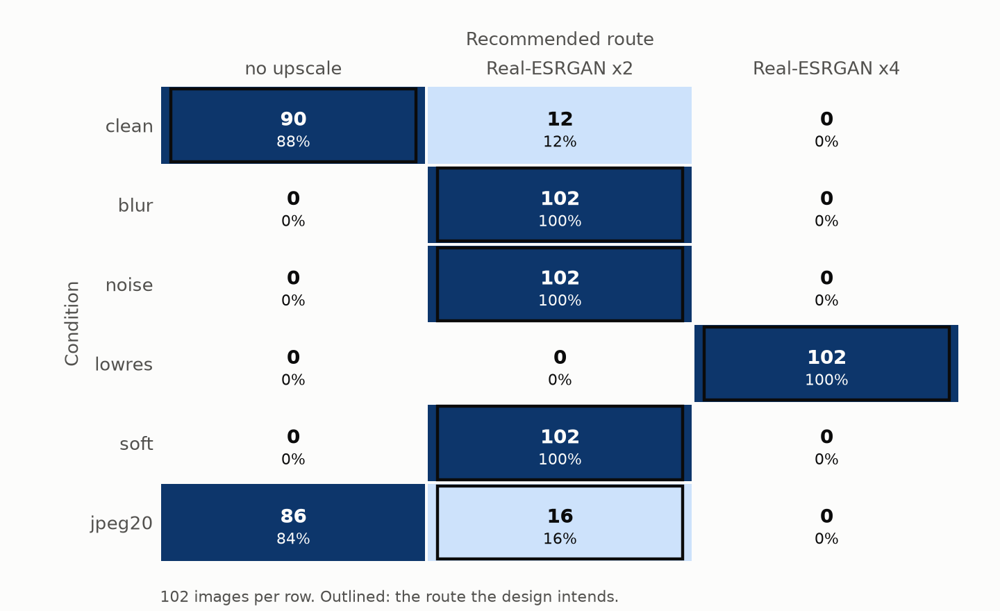
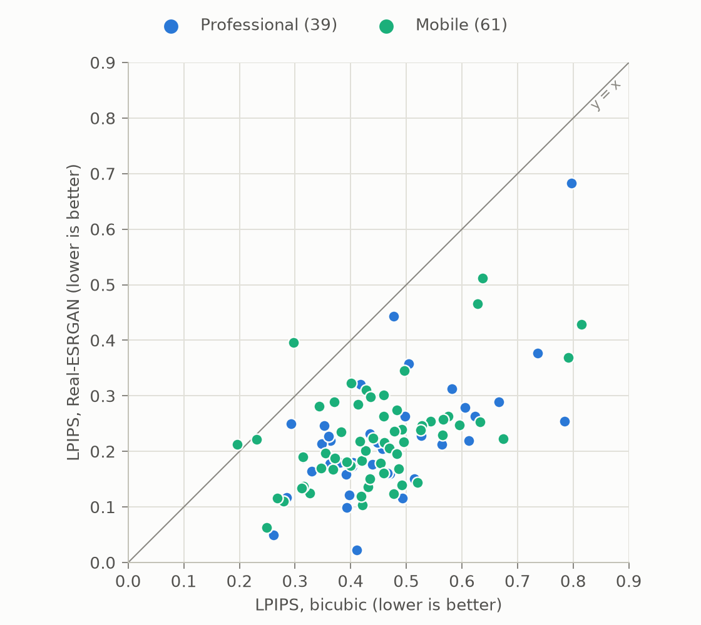
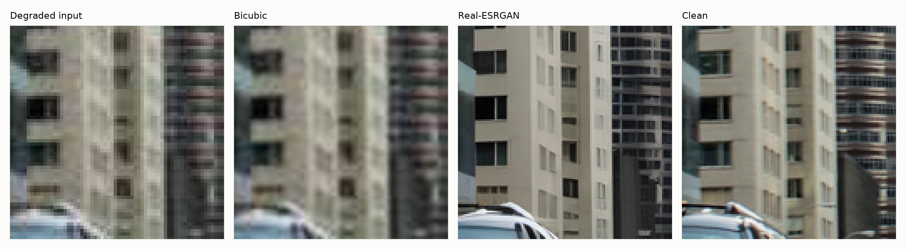
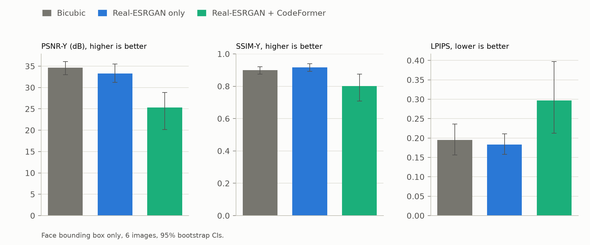
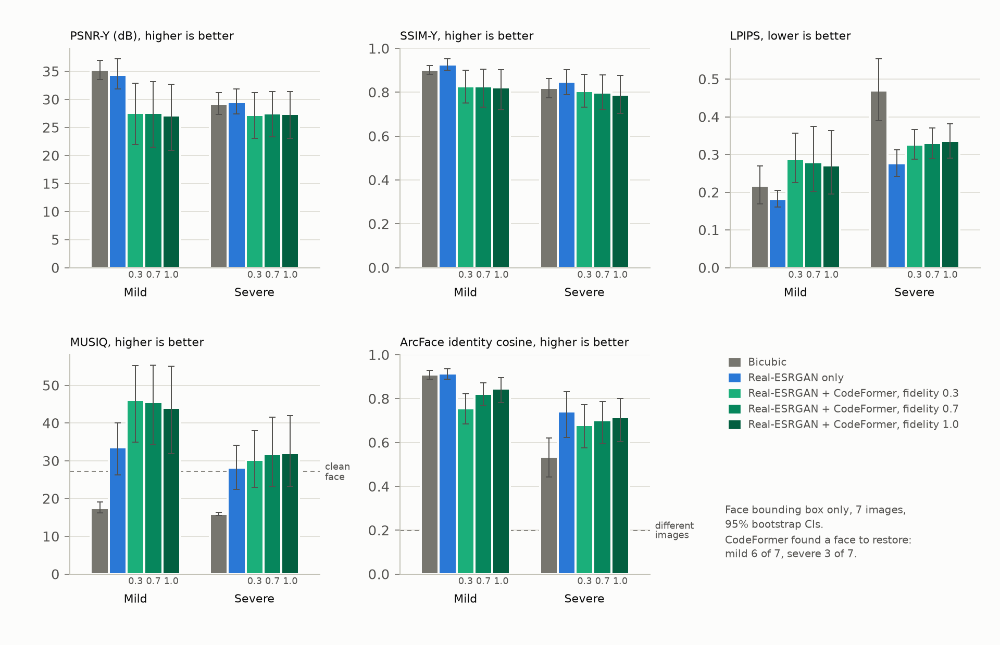

# AI Photo Restoration Studio: design and evaluation

## Summary

I tested each part of the app on the same set of 102 photos. Diagnose did well on the damage it measures. Every blurred, noisy, low-resolution and softened photo went to Real-ESRGAN. JPEG damage was a different story. Only 16 of the 102 compressed photos were routed there because Diagnose has no measure for compression.

Real-ESRGAN clearly beat bicubic on how the results look, winning on LPIPS for 98 of 100 crops and on MUSIQ for all 100. Pixel accuracy barely moved, though PSNR-Y was 0.21 dB lower on average. Faces were the weak spot. Across the 7 face photos, every time CodeFormer ran it raised MUSIQ, but the faces ended up less like the actual person than with Real-ESRGAN alone, on every faithfulness measure and on identity.

The deepest test was on Brush Repair. On the 92 photos larger than the 1536 px size LaMa works at, keeping LaMa’s raw output changed about 78% of the pixels far from any repair. Pasting only the fill back into the original changed none of them. The same measurements showed that my soft edge was mixing some of the damage back into the repair. Moving it outside the mask improved the repair on all 92 photos, by about 1.1 to 1.25 dB, at a cost I could measure in a narrow ring just outside it.  


## Motivation

Photos fail in different ways and each kind of damage needs its own model. Blur, noise and low resolution affect the whole frame. A face needs a model trained on faces and a scratch needs new content in one small area.

Each route should also leave the undamaged parts of a photo as they were. My app's Brush Repair tab runs LaMa on a copy of the photo whose long edge is at most 1536 px. Larger photos are shrunk to that size and the result is enlarged back. Every pixel goes through that round trip including pixels the user never touched.

A user who brushes over one scratch expects the rest of the photo to stay as it was. Resampling breaks that expectation in a way that is hard to see but easy to measure.

The usual answer is to paste only the repaired region back into the full-resolution original. I wanted to measure how well that works in my implementation and what its soft edge costs. I measured the other routes the same way.

## Related work and what this project adds

The models come from other authors. LaMa is by Suvorov et al. [1] which fills large masks using fast Fourier convolutions. Real-ESRGAN is by Wang et al. [2] which restores and upscales degraded photos. CodeFormer is by Zhou et al. [3] which restores faces.

I ran LaMa through simple-lama-inpainting [4] and loaded the other two with spandrel [5]. Face detection and identity use facexlib [13], which packages RetinaFace [14] and ArcFace [15].

Pasting an inpainted region back at full resolution is an established technique. [IOPaint](https://github.com/Sanster/IOPaint) [6], formerly Lama Cleaner, offers it as its **Resize** strategy, my compositing follows the same idea. Resize shrinks the image for inpainting and enlarges the result back, so the area outside the mask keeps its quality. Its **Crop** strategy instead inpaints a crop of the masked area with a margin at the original resolution.

What this project adds is measurement of every route on the same photos. The measurements exposed a defect in my own feathering, which I fixed. They also exposed a JPEG gap in Diagnose and a dependence on the damage colour above the resize cap.

## System overview

Auto Restore starts with Diagnose. It measures the number and area of faces, sharpness as the variance of the Laplacian, a noise estimate and the image size. From these it recommends CodeFormer for faces and Real-ESRGAN for blur, noise or low resolution and shows its reasons.

The thresholds are fixed. A photo counts as soft below a sharpness of 120 and noisy above a noise estimate of '6.0'. It counts as low resolution below a 900 px long edge. Real-ESRGAN then runs at 4x below a 500 px long edge and at 2x otherwise.

Diagnose does not look for scratches, tears or other localized damage and it does not measure JPEG compression. The user marks localized damage with the brush in Brush Repair and LaMa fills the marked area.

Brush Repair adds a compositing step after LaMa and Figure A shows its two paths. The raw path returns LaMa's output after the round trip through 1536 px. The composite path blends that output into the damaged input with a soft mask, so only the mask and a thin band around it can change.


*Figure A. Brush Repair's two paths. N1 is LaMa's output after the round trip; C_3 is that output composited into the damaged image with the feather outside the mask.*
{: .caption}

Each restore shows no-reference scores and the Benchmark tab scores restorations of synthetically degraded images against the clean original.

## How the evaluation works

Every evaluation uses the validation set of CLIC 2020 [7]: 102 photos, 61 from its Mobile split and 41 from its Professional split. All damage is synthetic and seeded, and every model ran on the CPU.

Full-reference scores compare an output with the clean photo. PSNR-Y and SSIM-Y [12] on BT.601 luma [9], and LPIPS [10]. No-reference scores rate an image on its own. MUSIQ [16] predicts human opinion scores and NIQE [17] measures distance from natural-image statistics. Apart from region PSNR-Y in the compositing experiment, all of them come from pyiqa [11].

Every mean comes with a 95% percentile bootstrap interval from 10,000 resamples of images, with seed 0. For comparisons between two outputs I bootstrapped the per-image differences and counted the images that got better, stayed equal or got worse.

For routing, I resized each photo to a 1024 px long edge. I then made six versions: clean, blurred (sigma 2), noisy (sigma 15), downscaled 4x, soft and JPEG at quality 20. Soft is the 4x downscale enlarged back with bicubic. I wrote down the route each version should get before running Diagnose.

For upscaling, I took the 512 by 512 centre crop of each photo. The Benchmark tab's default damage follows: blur (sigma 1), a 2x downscale, noise (sigma 8) and JPEG at quality 60. Real-ESRGAN restored each crop with face restoration off, against a bicubic baseline. Two photos are too small for the crop, so 100 were scored.

For faces, I cropped a square twice the size of each usable face, resized it to 512 px and damaged it at two levels. Mild uses the Benchmark defaults; severe uses a 4x downscale, blur (sigma 2), noise (sigma 15) and JPEG at quality 30. I compared bicubic, Real-ESRGAN alone and Real-ESRGAN with CodeFormer at fidelity 0.3, 0.7 and 1.0, on the face box only. Identity similarity is the cosine between ArcFace embeddings of the output and the clean face.

For Brush Repair, I drew seeded masks at 1%, 5% and 15% coverage for each image, which gave 306 pairs. Each mask mixes thin strokes with filled blobs. Inside the mask I overwrote the pixels with a bright fill of 235 plus Gaussian noise with a standard deviation of 10, giving the damaged image D. Of the 102 photos, 92 are larger than the 1536 px cap and 10 are not, so I reported the two groups separately.

Two smaller checks cover the Real-ESRGAN input handling, on 10 Mobile crops and whether LaMa's output depends on the damage colour.

## Diagnose and routing

Diagnose routed the damage it is built for as designed. Every blurred, noisy and soft version went to Real-ESRGAN x2, reportedly 102 of 102 in each case. Every low-resolution version at a 256 px long edge went to x4.

The margins were wide. No blurred version had a sharpness above 20.63, against a threshold of 120. No noisy version had a noise estimate below 8.72, against 6.0.

On the clean versions, 90 of 102 (88.2% [81.4%, 94.1%]) got no upscaling, as intended. The other 12 (11.8% [5.9%, 18.6%]) went to Real-ESRGAN x2, where 6 tripped the softness flag and 6 the noise flag. I have not checked whether these photos look soft or noisy to a viewer, so for now I count them as false positives.

Another 12 clean photos, none among those 12, had face restoration turned on because they contain faces, as designed. In total, 24 of 102 clean photos received some recommendation.

JPEG damage is where routing falls short. Only 16 of 102 JPEG versions (15.7% [8.8%, 22.5%]) went to Real-ESRGAN, all through the softness flag. Six of those 16 had already gone there when clean. Compression lowered the noise estimate from a mean of 2.91 on the clean versions to 1.13.

Diagnose has no measure of compression, so a blocky photo that stays sharp gets no upscaling. The fix is to add one, such as edge strength on JPEG's block grid. Leaving out the 5 photos enlarged to reach 1024 px gives 86 of 97 clean and 15 of 97 JPEG versions routed as expected.



*Chart 1. Diagnose's recommendation for six versions of each of the 102 photos; outlined cells are the routes the design intends. Blur, noise, low resolution and soft land in their intended cell for every photo, while 86 of 102 JPEG versions get no upscaling.*
{: .caption}

<!-- BEGIN routing -->

| Condition | Expected route | no upscale | Real-ESRGAN x2 | Real-ESRGAN x4 | Routed as expected [95% CI] |
|---|---|---:|---:|---:|---:|
| clean | no upscale | 90 (88.2%) | 12 (11.8%) | 0 (0.0%) | 90 / 102: 88.2% [81.4%, 94.1%] |
| blur | Real-ESRGAN x2 | 0 (0.0%) | 102 (100.0%) | 0 (0.0%) | 102 / 102: 100.0% [100.0%, 100.0%] |
| noise | Real-ESRGAN x2 | 0 (0.0%) | 102 (100.0%) | 0 (0.0%) | 102 / 102: 100.0% [100.0%, 100.0%] |
| lowres | Real-ESRGAN x4 | 0 (0.0%) | 0 (0.0%) | 102 (100.0%) | 102 / 102: 100.0% [100.0%, 100.0%] |
| soft | Real-ESRGAN x2 | 0 (0.0%) | 102 (100.0%) | 0 (0.0%) | 102 / 102: 100.0% [100.0%, 100.0%] |
| jpeg20 | Real-ESRGAN x2 | 86 (84.3%) | 16 (15.7%) | 0 (0.0%) | 16 / 102: 15.7% [8.8%, 22.5%] |

<!-- END routing -->

*Table 1. Diagnose's recommended route for each condition across the 102 photos, with the share routed as expected and its 95% interval.*
{: .caption}

## Upscaling

Real-ESRGAN improved every score except PSNR-Y. Mean LPIPS fell from 0.4561 with bicubic to 0.2246, better on 98 of 100 crops. MUSIQ rose from 31.98 to 62.43, better on all 100. NIQE fell from 5.677 to 4.938, better on 78 and SSIM-Y rose from 0.7676 to 0.7879, better on 76.

PSNR-Y fell from 29.01 to 28.80 dB and was better on only 39 crops. The difference, −0.21 dB [−0.50, +0.05] includes zero. The splits agree on LPIPS. Real-ESRGAN was better on 39 of 39 Professional crops and 59 of 61 Mobile crops. On Professional crops, PSNR-Y fell by 0.47 dB [−0.89, −0.04] and was better on 11 of 39.



*Chart 2. LPIPS of each crop with bicubic (x) and Real-ESRGAN (y). 98 of 100 points lie below y = x, where Real-ESRGAN is better and the two above it are Mobile crops.*
{: .caption}

<!-- BEGIN upscale -->

| Split (images) | Metric | Bicubic | Real-ESRGAN | Real-ESRGAN − bicubic | Real-ESRGAN better / equal / worse |
|---|---|---:|---:|---:|---:|
| All (100, 2 excluded) | PSNR-Y (dB) | 29.01 [28.16, 29.87] | 28.80 [27.85, 29.75] | -0.21 [-0.50, +0.05] | 39 / 0 / 61 |
| All (100, 2 excluded) | SSIM-Y | 0.7676 [0.7440, 0.7900] | 0.7879 [0.7593, 0.8145] | +0.0203 [+0.0125, +0.0275] | 76 / 0 / 24 |
| All (100, 2 excluded) | LPIPS | 0.4561 [0.4321, 0.4812] | 0.2246 [0.2064, 0.2449] | -0.2315 [-0.2516, -0.2107] | 98 / 0 / 2 |
| All (100, 2 excluded) | MUSIQ | 31.98 [30.35, 33.61] | 62.43 [60.28, 64.46] | +30.45 [+28.48, +32.39] | 100 / 0 / 0 |
| All (100, 2 excluded) | NIQE | 5.677 [5.580, 5.779] | 4.938 [4.546, 5.398] | -0.739 [-1.102, -0.325] | 78 / 0 / 22 |
| Professional (39, 2 excluded) | PSNR-Y (dB) | 28.77 [27.48, 30.11] | 28.30 [26.87, 29.84] | -0.47 [-0.89, -0.04] | 11 / 0 / 28 |
| Professional (39, 2 excluded) | SSIM-Y | 0.7635 [0.7239, 0.8007] | 0.7754 [0.7257, 0.8220] | +0.0119 [-0.0021, +0.0254] | 27 / 0 / 12 |
| Professional (39, 2 excluded) | LPIPS | 0.4704 [0.4320, 0.5107] | 0.2239 [0.1917, 0.2616] | -0.2465 [-0.2796, -0.2131] | 39 / 0 / 0 |
| Professional (39, 2 excluded) | MUSIQ | 31.37 [28.29, 34.65] | 61.05 [57.14, 64.61] | +29.68 [+26.46, +32.82] | 39 / 0 / 0 |
| Professional (39, 2 excluded) | NIQE | 5.828 [5.663, 5.997] | 5.087 [4.457, 5.901] | -0.740 [-1.344, +0.019] | 32 / 0 / 7 |
| Mobile (61) | PSNR-Y (dB) | 29.17 [28.07, 30.29] | 29.12 [27.88, 30.37] | -0.05 [-0.41, +0.28] | 28 / 0 / 33 |
| Mobile (61) | SSIM-Y | 0.7702 [0.7410, 0.7979] | 0.7958 [0.7626, 0.8270] | +0.0256 [+0.0173, +0.0335] | 49 / 0 / 12 |
| Mobile (61) | LPIPS | 0.4469 [0.4173, 0.4781] | 0.2250 [0.2040, 0.2474] | -0.2218 [-0.2484, -0.1955] | 59 / 0 / 2 |
| Mobile (61) | MUSIQ | 32.37 [30.60, 34.06] | 63.31 [60.70, 65.56] | +30.95 [+28.48, +33.37] | 61 / 0 / 0 |
| Mobile (61) | NIQE | 5.581 [5.467, 5.695] | 4.842 [4.354, 5.383] | -0.738 [-1.184, -0.250] | 46 / 0 / 15 |

<!-- END upscale -->

*Table 2. Upscaling scores on the centre crops, overall and per split, with 95% intervals and Real-ESRGAN's better, equal and worse counts.*
{: .caption}

Figure B shows the Professional crop whose LPIPS gain over bicubic, 0.2303, is closest to the median gain of 0.2311. Bicubic keeps the blur and blocky colour noise of the degraded input. Real-ESRGAN produces sharp window frames and flat, clean walls.

Some of that detail is not in the photo. On the right, the clean building has reddish horizontal bands between its rows of windows. Real-ESRGAN replaces them with a regular grid of grey and black panes and drops the red.



*Figure B. A 128 px window from the median-gain Professional crop; the degraded input is at 8x and the rest at 4x. Real-ESRGAN draws sharp windows, including a grey grid on the right where the clean image has reddish bands.*
{: .caption}

Blau and Michaeli call this the perception–distortion trade-off [18]. Beyond a point, a restorer cannot both look more natural and stay closer to the original. LPIPS rewards texture that resembles the original in a learned feature space and MUSIQ rewards images that people rate as sharp and natural. Neither checks that each window sits where the photo had it and PSNR-Y, which does, did not improve.

Auto Restore and the Benchmark tab can ask Real-ESRGAN for 2x output but the network I use always upscales by 4x. The old code first shrank the input to half size, so that 4x would land on 2x. That discarded detail before the network saw it.

The current code runs the 4x network on the full input in 256 px tiles with 16 px of context. It then resamples the result to the target size with Lanczos.

<!-- BEGIN upscaler -->

| Method (10 Mobile crops, 512×512) | PSNR-Y (dB) mean | min | max | SSIM-Y mean | min | max | LPIPS mean | min | max |
|---|---:|---:|---:|---:|---:|---:|---:|---:|---:|
| Bicubic | 29.97 | 24.86 | 37.48 | 0.7967 | 0.6140 | 0.9074 | 0.4682 | 0.3137 | 0.6745 |
| Real-ESRGAN, old path | 28.88 | 23.13 | 38.61 | 0.7940 | 0.5628 | 0.9550 | 0.2099 | 0.1254 | 0.3059 |
| Real-ESRGAN, fixed path | 30.28 | 24.82 | 39.09 | 0.8320 | 0.6125 | 0.9586 | 0.1843 | 0.1237 | 0.2347 |

<!-- END upscaler -->

*Table 3. Bicubic, the old Real-ESRGAN path and the fixed path on 10 Mobile crops with the mean, minimum and maximum of each score.*
{: .caption}

On 10 Mobile crops, mean PSNR-Y rose from 28.88 to 30.28 dB and mean SSIM-Y from 0.7940 to 0.8320. Mean LPIPS fell from 0.2099 to 0.1843. The current path beat the old one on PSNR-Y and SSIM-Y for all 10 crops and on LPIPS for 9.

The fix costs time; with a 512 px input, the median time on the CPU rose from 13.59 s to 52.80 s. On those 10 crops its mean PSNR-Y also beat bicubic's, 30.28 against 29.97 dB unlike the 100-crop mean.

## Face restoration

The app's face detector found a face in 15 of the 102 photos; 7 have one at least 64 px on its larger side. When Diagnose finds a face, CodeFormer restores each face it detects, with a fidelity value from 0 to 1.

The app passes that value to CodeFormer unchanged. At 0 it leans on the model's learned face prior and at 1 it stays closest to the input, including more of its damage. The default is 0.7 and Diagnose recommends 0.5 for photos it flags as soft or noisy.

Wherever CodeFormer ran, it scored higher on MUSIQ than Real-ESRGAN alone and worse on PSNR-Y, SSIM-Y, LPIPS and identity. At mild damage it ran on 6 of the 7 photos and was worse on all four measures for each of them at every fidelity. Mean PSNR-Y was 27.08 to 27.58 dB, against 34.39 dB for Real-ESRGAN alone.

Higher fidelity kept identity closer. Mean identity similarity was 0.7567, 0.8220 and 0.8464 at fidelity 0.3, 0.7 and 1.0 against 0.9139 for Real-ESRGAN alone. For reference, clean faces of different people score 0.1994 [0.1557, 0.2453] across 21 pairs.

Severe damage is the case CodeFormer is designed for, yet here it rarely ran. It detects faces again on the damaged input which at this level is 128 px on a side. It found the face in only 3 of 7 photos and on the other 4 the app returned Real-ESRGAN's output unchanged.

Where it ran, it was worse on PSNR-Y, SSIM-Y, LPIPS and identity for all 3 and better on MUSIQ for all 3.

On severe damage, Real-ESRGAN alone raised identity similarity from 0.5349 with bicubic to 0.7408, better on 6 of 7 photos. LPIPS fell from 0.4701 to 0.2766.

MUSIQ shows what a no-reference score measures. The clean faces score 27.24 [21.15, 34.65] while CodeFormer's mild-damage faces score 44.04 to 46.09. MUSIQ rates how sharp and natural a face looks, so a convincing face scores well even if it is someone else. Faithfulness needs a reference, such as the identity score here.



*Chart 3. The first face run: 6 photos with a face at least 64 px wide, mild damage, fidelity 0.7, with 95% intervals. Real-ESRGAN with CodeFormer has the lowest PSNR-Y and SSIM-Y and the highest LPIPS of the three.*
{: .caption}

<!-- BEGIN faces -->

| Method (face box, 6 images) | PSNR-Y (dB) | SSIM-Y | LPIPS |
|---|---:|---:|---:|
| Bicubic | 34.62 [33.00, 36.07] | 0.8987 [0.8753, 0.9202] | 0.1953 [0.1566, 0.2363] |
| Real-ESRGAN only | 33.30 [31.18, 35.49] | 0.9168 [0.8928, 0.9403] | 0.1831 [0.1577, 0.2108] |
| Real-ESRGAN + CodeFormer | 25.35 [20.16, 28.83] | 0.8019 [0.7084, 0.8755] | 0.2972 [0.2121, 0.3970] |
| CodeFormer vs Real-ESRGAN only: better / equal / worse | 0 / 0 / 6 | 0 / 0 / 6 | 0 / 0 / 6 |
| CodeFormer vs bicubic: better / equal / worse | 0 / 0 / 6 | 0 / 0 / 6 | 3 / 0 / 3 |

<!-- END faces -->

*Table 4. The first face run: face-box scores on 6 photos at mild damage and fidelity 0.7, with 95% intervals and CodeFormer's per-photo counts.*
{: .caption}

In that first run, CodeFormer's mean PSNR-Y was 25.35 dB against 33.30 dB for Real-ESRGAN alone. The second run's mild level reproduces all 54 of its values.



*Chart 4. Face-box scores for 7 photos at two damage levels, with CodeFormer at fidelity 0.3, 0.7 and 1.0 and 95% intervals. Dashed lines mark the clean faces' MUSIQ and the identity score between different people.*
{: .caption}

<!-- BEGIN faces_sweep -->

**Mild damage** (Benchmark tab default: half resolution, light blur, noise and JPEG). Face area only, 7 photos. CodeFormer found the face in 6 of the 7 at every fidelity.

| Method | PSNR-Y (dB) | SSIM-Y | LPIPS | MUSIQ | Identity cosine |
|---|---:|---:|---:|---:|---:|
| Bicubic | 35.25 [33.47, 36.98] | 0.9032 [0.8808, 0.9220] | 0.2172 [0.1685, 0.2700] | 17.39 [16.20, 19.04] | 0.9101 [0.8889, 0.9285] |
| Real-ESRGAN only | 34.39 [31.82, 37.22] | 0.9260 [0.8998, 0.9518] | 0.1819 [0.1602, 0.2051] | 33.56 [26.23, 40.01] | 0.9139 [0.8881, 0.9361] |
| Real-ESRGAN + CodeFormer, fidelity 0.3 | 27.57 [21.95, 32.91] | 0.8278 [0.7510, 0.9009] | 0.2880 [0.2256, 0.3567] | 46.09 [34.96, 55.18] | 0.7567 [0.6834, 0.8210] |
| Real-ESRGAN + CodeFormer, fidelity 0.7 | 27.58 [21.51, 33.12] | 0.8275 [0.7320, 0.9050] | 0.2797 [0.2028, 0.3740] | 45.53 [34.18, 55.32] | 0.8220 [0.7668, 0.8711] |
| Real-ESRGAN + CodeFormer, fidelity 1.0 | 27.08 [20.92, 32.66] | 0.8213 [0.7193, 0.9026] | 0.2715 [0.1952, 0.3637] | 44.04 [31.91, 55.07] | 0.8464 [0.7816, 0.8963] |
| Bicubic vs Real-ESRGAN only: better / equal / worse | 3 / 0 / 4 | 2 / 0 / 5 | 2 / 0 / 5 | 0 / 0 / 7 | 3 / 0 / 4 |
| Real-ESRGAN + CodeFormer, fidelity 0.3 vs Real-ESRGAN only: better / equal / worse | 0 / 1 / 6 | 0 / 1 / 6 | 0 / 1 / 6 | 6 / 1 / 0 | 0 / 1 / 6 |
| Real-ESRGAN + CodeFormer, fidelity 0.7 vs Real-ESRGAN only: better / equal / worse | 0 / 1 / 6 | 0 / 1 / 6 | 0 / 1 / 6 | 6 / 1 / 0 | 0 / 1 / 6 |
| Real-ESRGAN + CodeFormer, fidelity 1.0 vs Real-ESRGAN only: better / equal / worse | 0 / 1 / 6 | 0 / 1 / 6 | 0 / 1 / 6 | 6 / 1 / 0 | 0 / 1 / 6 |

**Severe damage** (quarter resolution, heavy blur, noise and JPEG). Face area only, 7 photos. CodeFormer found the face in 3 of the 7 at every fidelity.

| Method | PSNR-Y (dB) | SSIM-Y | LPIPS | MUSIQ | Identity cosine |
|---|---:|---:|---:|---:|---:|
| Bicubic | 29.15 [27.34, 31.17] | 0.8195 [0.7749, 0.8621] | 0.4701 [0.3897, 0.5538] | 15.88 [15.50, 16.32] | 0.5349 [0.4424, 0.6209] |
| Real-ESRGAN only | 29.50 [27.42, 31.89] | 0.8481 [0.7899, 0.9026] | 0.2766 [0.2421, 0.3129] | 28.23 [22.40, 34.16] | 0.7408 [0.6239, 0.8306] |
| Real-ESRGAN + CodeFormer, fidelity 0.3 | 27.22 [23.05, 31.24] | 0.8062 [0.7312, 0.8811] | 0.3263 [0.2871, 0.3664] | 30.30 [23.01, 38.00] | 0.6798 [0.5760, 0.7716] |
| Real-ESRGAN + CodeFormer, fidelity 0.7 | 27.45 [23.30, 31.36] | 0.7984 [0.7198, 0.8789] | 0.3299 [0.2894, 0.3699] | 31.83 [23.27, 41.53] | 0.7003 [0.5936, 0.7875] |
| Real-ESRGAN + CodeFormer, fidelity 1.0 | 27.37 [23.00, 31.39] | 0.7897 [0.7031, 0.8765] | 0.3366 [0.2909, 0.3821] | 32.04 [23.29, 41.97] | 0.7143 [0.6048, 0.8003] |
| Bicubic vs Real-ESRGAN only: better / equal / worse | 2 / 0 / 5 | 1 / 0 / 6 | 1 / 0 / 6 | 0 / 0 / 7 | 1 / 0 / 6 |
| Real-ESRGAN + CodeFormer, fidelity 0.3 vs Real-ESRGAN only: better / equal / worse | 0 / 4 / 3 | 0 / 4 / 3 | 0 / 4 / 3 | 3 / 4 / 0 | 0 / 4 / 3 |
| Real-ESRGAN + CodeFormer, fidelity 0.7 vs Real-ESRGAN only: better / equal / worse | 0 / 4 / 3 | 0 / 4 / 3 | 0 / 4 / 3 | 3 / 4 / 0 | 0 / 4 / 3 |
| Real-ESRGAN + CodeFormer, fidelity 1.0 vs Real-ESRGAN only: better / equal / worse | 0 / 4 / 3 | 0 / 4 / 3 | 0 / 4 / 3 | 3 / 4 / 0 | 0 / 4 / 3 |

<!-- END faces_sweep -->

*Table 5. The second face run: face-box scores on 7 photos at mild and severe damage, with 95% intervals and per-photo counts against Real-ESRGAN alone.*
{: .caption}

These results rest on 7 photos, and on 3 where CodeFormer ran at severe damage, so the intervals are wide. Identity uses one alignment per photo, taken from the clean face's landmarks. A face whose features CodeFormer moved is therefore compared at the original position.

## Brush Repair and compositing

From each image and mask pair I built eight outputs. N1 is raw LaMa at the 1536 px cap and N2 is raw LaMa with the cap lowered to 512 px.

C_0, C_3 and C_15 composite N1's fill into D with my current feather, at blur radius 0, 3 and 15. C_3_legacy and C_15_legacy use my earlier feather, centred on the mask edge. C_3_N2fill composites the 512 px fill with the current feather.

I scored three regions against the clean original I. M is the mask itself, and H is the halo: the pixels outside M that a given feather reaches. The untouched region **U** is every pixel beyond the widest feather I tested, radius 15, so a correct composite must leave it unchanged. For two of the 10 smaller images, U is empty at 15% coverage, and I left those pairs out of the U averages.

In U I counted the share of pixels where any colour channel changed. In M I reported PSNR-Y and M LPIPS, which compares I with an image that holds the output inside M and I everywhere else. Off-repair LPIPS does the reverse, so it scores only what an output did to the rest of the photo.

### Untouched pixels

Above the cap, raw LaMa changed on average 78.01%, 77.20% and 77.34% of U at 1%, 5% and 15% coverage. Many of these changes are a single level: only 34.90 to 36.68% of U pixels moved by more than one level.

Lowering the cap to 512 px made this worse: N2 changed 92.97 to 93.31% of U. Every composite left every U pixel unchanged in all 306 pairs, apart from the two pairs with an empty U. Below the cap there is no round trip and raw LaMa also left U unchanged in all 10 images. That points to the resampling, not to LaMa itself, as the source of the changes outside the mask.

Figures C to G use one Professional photo above the cap, chosen by a fixed rule. It is the most typical one; at 5% damage, raw LaMa changed 79.89% of its untouched pixels, nearest the median of 79.32% for all 92 large photos.


[Full-resolution change maps](figures/fig_a_change_maps_full.png)

*Figure C. Absolute change from the original at 5% coverage, with the mask outlined. Raw LaMa changes pixels across the whole frame, most strongly in textured areas; the composite changes only the mask and a narrow band around it.*
{: .caption}


*Figure D. A 128 px crop from U at 4x: original, raw LaMa, 512 px LaMa and composite. Raw LaMa is hard to tell from the original and 512 px LaMa is visibly blurred; of 16,384 pixels, they changed 15,272 and 16,344, and the composite none.*
{: .caption}


*Chart 5. Share of U pixels changed by each output above the cap, with 95% intervals. The composite's bars sit at zero for every coverage.*
{: .caption}

<!-- BEGIN headline -->

| Metric | Condition | Above cap, 1% | Above cap, 5% | Above cap, 15% | At or below cap, 1% | At or below cap, 5% | At or below cap, 15% |
|---|---|---:|---:|---:|---:|---:|---:|
| **Pairs (u_empty)** |  | 92 (0) | 92 (0) | 92 (0) | 10 (0) | 10 (0) | 10 (2) |
| U changed (%) | N1 | 78.01 [75.69, 80.27] | 77.20 [74.77, 79.57] | 77.34 [74.77, 79.80] | 0.00 [0.00, 0.00] | 0.00 [0.00, 0.00] | 0.00 [0.00, 0.00] (n = 8) |
| U changed (%) | N2 | 93.31 [92.21, 94.35] | 92.97 [91.79, 94.08] | 93.31 [92.22, 94.35] | 85.20 [65.45, 97.34] | 86.18 [66.44, 97.51] | 96.67 [94.86, 98.39] (n = 8) |
| U changed (%) | C_3 | 0.00 [0.00, 0.00] | 0.00 [0.00, 0.00] | 0.00 [0.00, 0.00] | 0.00 [0.00, 0.00] | 0.00 [0.00, 0.00] | 0.00 [0.00, 0.00] (n = 8) |
| U changed by >1 level (%) | N1 | 36.68 [33.40, 40.02] | 35.61 [32.27, 39.00] | 34.90 [31.51, 38.36] | 0.00 [0.00, 0.00] | 0.00 [0.00, 0.00] | 0.00 [0.00, 0.00] (n = 8) |
| U changed by >1 level (%) | N2 | 70.25 [67.75, 72.72] | 69.17 [66.55, 71.80] | 69.09 [66.34, 71.83] | 69.56 [51.61, 83.35] | 71.00 [53.71, 83.17] | 79.40 [71.15, 87.40] (n = 8) |
| U changed by >1 level (%) | C_3 | 0.00 [0.00, 0.00] | 0.00 [0.00, 0.00] | 0.00 [0.00, 0.00] | 0.00 [0.00, 0.00] | 0.00 [0.00, 0.00] | 0.00 [0.00, 0.00] (n = 8) |
| M PSNR-Y (dB) | C_3_legacy | 10.19 [9.78, 10.61] | 10.92 [10.51, 11.37] | 12.11 [11.74, 12.50] | 12.62 [11.84, 13.32] | 14.36 [13.33, 15.28] | 14.46 [13.54, 15.32] |
| M PSNR-Y (dB) | C_3 | 11.37 [10.93, 11.83] | 12.03 [11.59, 12.51] | 13.35 [12.97, 13.77] | 22.94 [19.97, 26.04] | 22.54 [20.82, 24.86] | 20.76 [19.02, 22.51] |
| M PSNR-Y (dB) | C_3_N2fill | 12.57 [12.11, 13.07] | 12.74 [12.30, 13.21] | 14.56 [14.21, 14.95] | 14.72 [11.86, 19.13] | 15.39 [12.83, 19.32] | 15.58 [13.90, 18.18] |
| Off-repair LPIPS | C_3_legacy | 0.0034 [0.0026, 0.0043] | 0.0131 [0.0104, 0.0162] | 0.0338 [0.0276, 0.0409] | 0.0000 [0.0000, 0.0000] | 0.0000 [0.0000, 0.0000] | 0.0000 [0.0000, 0.0000] |
| Off-repair LPIPS | C_3 | 0.0130 [0.0111, 0.0150] | 0.0479 [0.0415, 0.0549] | 0.1082 [0.0950, 0.1228] | 0.0000 [0.0000, 0.0000] | 0.0000 [0.0000, 0.0000] | 0.0000 [0.0000, 0.0000] |
| Off-repair LPIPS | C_3_N2fill | 0.0240 [0.0217, 0.0264] | 0.0882 [0.0808, 0.0962] | 0.1908 [0.1765, 0.2064] | 0.0139 [0.0096, 0.0178] | 0.0507 [0.0370, 0.0619] | 0.1086 [0.0782, 0.1349] |
| Off-repair LPIPS | N1 | 0.0519 [0.0464, 0.0577] | 0.0833 [0.0753, 0.0915] | 0.1361 [0.1226, 0.1506] | 0.0000 [0.0000, 0.0000] | 0.0000 [0.0000, 0.0000] | 0.0000 [0.0000, 0.0000] |
| Off-repair LPIPS | N2 | 0.3818 [0.3580, 0.4063] | 0.4063 [0.3842, 0.4289] | 0.4334 [0.4145, 0.4534] | 0.2787 [0.1941, 0.3605] | 0.2861 [0.2013, 0.3663] | 0.2841 [0.2021, 0.3604] |

<!-- END headline -->

*Table 6. Brush Repair results for each output by size class and coverage, with 95% intervals; the U rows leave out pairs with an empty U.*
{: .caption}

### Refining the feathered edge

My first compositing code blurred the mask with a Gaussian centred on the mask edge. That puts part of the soft ramp inside the mask, so pixels near the inner edge keep part of the damaged fill. The current code first dilates the mask by the blur's reach, then blurs it. Alpha is then exactly 1 on every mask pixel, and the whole ramp lies outside M.

Pillow's Gaussian blur is an extended box filter [8] with a finite footprint. I measured its effective reach as 8 px at radius 3 and 40 px at radius 15. Above the cap, the legacy radius 3 feather gave the damaged pixels a mean weight inside M of 0.2236, 0.1758 and 0.1466. The current feather gives them 0.


*Figure E. A mask edge at 4x: damaged input, legacy composite and current composite. The legacy result keeps a pale, see-through trace of the damage; the current one shows LaMa's own fill, which is crisper but still a visible pale streak here.*
{: .caption}


*Figure E, alpha profile. Alpha along a line across the Figure E edge. The legacy alpha peaks at 0.663 inside the mask and drops to 0.376 at its inner edge, while the current alpha is 1 across the mask and falls to 0 by 17.5 px outside it.*
{: .caption}

Inside M the fix raised PSNR-Y in all 306 pairs. Above the cap the mean gain was 1.183, 1.106 and 1.246 dB, with all 92 images better at each coverage. Below the cap it was 10.319, 8.175 and 6.297 dB. There the fill was closer to the original, at 20.76 to 22.94 dB inside M against 11.37 to 13.35 dB above the cap.

The pale streak in the current composite is not left over from the old feather. It is LaMa's own fill above the cap. Its output inside the mask depends on the colour of the damage, which I look at under [next steps](#brush-repair).


*Chart 6. M PSNR-Y of the legacy composite against the current one, per image and coverage, above the cap and at or below it. All 306 points lie above the y = x line.*
{: .caption}

The fix moves the soft edge onto pixels the old feather left alone. On the test images, the radius 3 feather now reaches 19.42 px beyond the mask, against 8.49 px before. Above the cap those pixels take part of LaMa's round-tripped output. Off-repair LPIPS rose by 0.0096, 0.0348 and 0.0744, worse for all 92 images at each coverage.

Below the cap, no halo pixel changed under either feather.

Figure F compares a hard edge with the radius 3 feather at the Figure E location. I saw no clear seam in either, though one edge is not a general test.


*Figure F. The same spot as Figure E. LaMa's fill pasted back with a hard edge and with a soft edge, next to the original. Here the two look almost the same.*
{: .caption}


*Chart 7. Furthest distance from the mask at which any pixel changes, for feather radius 0, 3 and 15, measured on the two synthetic test images. The current feather reaches 19.42 and 97.45 px at radius 3 and 15, the legacy feather 8.49 and 41.01 px.*
{: .caption}

### A lower-resolution fill

Above the cap, N2 scored higher than N1 inside the mask, so I tried compositing the 512 px fill with the current feather (C_3_N2fill). It raised M PSNR-Y over C_3 by 1.202, 0.714 and 1.210 dB, for 77, 72 and 90 of the 92 images.

Outside the mask, the feather blends the blurrier 512 px fill into the halo. Off-repair LPIPS rose by 0.0110, 0.0403 and 0.0825 compared with C_3, worse for all 92 images. At 5% and 15% coverage it was even higher than raw N1's: 0.0882 against 0.0833, and 0.1908 against 0.1361. Below the cap the 512 px fill was worse inside the mask for 9 of the 10 images.


*Figure G. The same spot with LaMa run at 1536 px and at 512 px, next to the original. The 512 px repair is blurrier but the pale streak still shows.*
{: .caption}


*Chart 8. Off-repair LPIPS against M LPIPS at 5% coverage above the cap, with 95% intervals on both axes and a log x axis. C_3_legacy has the lowest off-repair LPIPS and C_3_N2fill the lowest M LPIPS among the composites.*
{: .caption}

Table 7 lists every per-image comparison in this section.

<details markdown="1">
<summary>Show all 90 per-image comparisons</summary>

<!-- BEGIN paired -->

| Size class | Coverage | Comparison (a − b) | Metric | Mean difference [95% CI] | a better / equal / worse | n |
|---|---:|---|---|---:|---:|---:|
| Above cap | 1% | C_3 − C_3_legacy | M PSNR-Y (dB) | +1.183 [+1.090, +1.285] | 92 / 0 / 0 | 92 |
| Above cap | 1% | C_3 − C_3_legacy | M LPIPS | -0.0038 [-0.0041, -0.0034] | 92 / 0 / 0 | 92 |
| Above cap | 1% | C_3 − C_3_legacy | Off-repair LPIPS | +0.0096 [+0.0084, +0.0108] | 0 / 0 / 92 | 92 |
| Above cap | 1% | C_3 − N1 | M PSNR-Y (dB) | +0.000 [+0.000, +0.000] | 0 / 92 / 0 | 92 |
| Above cap | 1% | C_3 − N1 | M LPIPS | +0.0000 [+0.0000, +0.0000] | 0 / 92 / 0 | 92 |
| Above cap | 1% | C_3 − N1 | U mean abs diff | -1.618 [-1.857, -1.405] | 92 / 0 / 0 | 92 |
| Above cap | 1% | C_3 − N2 | M PSNR-Y (dB) | -1.202 [-1.468, -0.931] | 15 / 0 / 77 | 92 |
| Above cap | 1% | C_3 − N2 | M LPIPS | +0.0060 [+0.0051, +0.0069] | 6 / 0 / 86 | 92 |
| Above cap | 1% | C_3 − N2 | U mean abs diff | -5.121 [-5.788, -4.511] | 92 / 0 / 0 | 92 |
| Above cap | 1% | C_3_N2fill − C_3 | M PSNR-Y (dB) | +1.202 [+0.931, +1.468] | 77 / 0 / 15 | 92 |
| Above cap | 1% | C_3_N2fill − C_3 | M LPIPS | -0.0060 [-0.0069, -0.0051] | 86 / 0 / 6 | 92 |
| Above cap | 1% | C_3_N2fill − C_3 | Off-repair LPIPS | +0.0110 [+0.0102, +0.0118] | 0 / 0 / 92 | 92 |
| Above cap | 1% | C_3_N2fill − N2 | M PSNR-Y (dB) | +0.000 [+0.000, +0.000] | 0 / 92 / 0 | 92 |
| Above cap | 1% | C_3_N2fill − N2 | M LPIPS | +0.0000 [+0.0000, +0.0000] | 0 / 92 / 0 | 92 |
| Above cap | 1% | C_3_N2fill − N2 | Off-repair LPIPS | -0.3578 [-0.3828, -0.3336] | 92 / 0 / 0 | 92 |
| Above cap | 5% | C_3 − C_3_legacy | M PSNR-Y (dB) | +1.106 [+1.028, +1.187] | 92 / 0 / 0 | 92 |
| Above cap | 5% | C_3 − C_3_legacy | M LPIPS | -0.0129 [-0.0141, -0.0119] | 92 / 0 / 0 | 92 |
| Above cap | 5% | C_3 − C_3_legacy | Off-repair LPIPS | +0.0348 [+0.0308, +0.0391] | 0 / 0 / 92 | 92 |
| Above cap | 5% | C_3 − N1 | M PSNR-Y (dB) | +0.000 [+0.000, +0.000] | 0 / 92 / 0 | 92 |
| Above cap | 5% | C_3 − N1 | M LPIPS | +0.0000 [+0.0000, +0.0000] | 0 / 92 / 0 | 92 |
| Above cap | 5% | C_3 − N1 | U mean abs diff | -1.565 [-1.797, -1.356] | 92 / 0 / 0 | 92 |
| Above cap | 5% | C_3 − N2 | M PSNR-Y (dB) | -0.714 [-0.919, -0.508] | 20 / 0 / 72 | 92 |
| Above cap | 5% | C_3 − N2 | M LPIPS | +0.0177 [+0.0152, +0.0200] | 6 / 0 / 86 | 92 |
| Above cap | 5% | C_3 − N2 | U mean abs diff | -4.952 [-5.612, -4.327] | 92 / 0 / 0 | 92 |
| Above cap | 5% | C_3_N2fill − C_3 | M PSNR-Y (dB) | +0.714 [+0.508, +0.919] | 72 / 0 / 20 | 92 |
| Above cap | 5% | C_3_N2fill − C_3 | M LPIPS | -0.0177 [-0.0200, -0.0152] | 86 / 0 / 6 | 92 |
| Above cap | 5% | C_3_N2fill − C_3 | Off-repair LPIPS | +0.0403 [+0.0376, +0.0431] | 0 / 0 / 92 | 92 |
| Above cap | 5% | C_3_N2fill − N2 | M PSNR-Y (dB) | +0.000 [+0.000, +0.000] | 0 / 92 / 0 | 92 |
| Above cap | 5% | C_3_N2fill − N2 | M LPIPS | +0.0000 [+0.0000, +0.0000] | 0 / 92 / 0 | 92 |
| Above cap | 5% | C_3_N2fill − N2 | Off-repair LPIPS | -0.3182 [-0.3408, -0.2961] | 92 / 0 / 0 | 92 |
| Above cap | 15% | C_3 − C_3_legacy | M PSNR-Y (dB) | +1.246 [+1.174, +1.319] | 92 / 0 / 0 | 92 |
| Above cap | 15% | C_3 − C_3_legacy | M LPIPS | -0.0250 [-0.0269, -0.0234] | 92 / 0 / 0 | 92 |
| Above cap | 15% | C_3 − C_3_legacy | Off-repair LPIPS | +0.0744 [+0.0667, +0.0827] | 0 / 0 / 92 | 92 |
| Above cap | 15% | C_3 − N1 | M PSNR-Y (dB) | +0.000 [+0.000, +0.000] | 0 / 92 / 0 | 92 |
| Above cap | 15% | C_3 − N1 | M LPIPS | +0.0000 [+0.0000, +0.0000] | 0 / 92 / 0 | 92 |
| Above cap | 15% | C_3 − N1 | U mean abs diff | -1.458 [-1.666, -1.273] | 92 / 0 / 0 | 92 |
| Above cap | 15% | C_3 − N2 | M PSNR-Y (dB) | -1.210 [-1.382, -1.042] | 2 / 0 / 90 | 92 |
| Above cap | 15% | C_3 − N2 | M LPIPS | +0.0257 [+0.0210, +0.0302] | 9 / 0 / 83 | 92 |
| Above cap | 15% | C_3 − N2 | U mean abs diff | -4.611 [-5.234, -4.038] | 92 / 0 / 0 | 92 |
| Above cap | 15% | C_3_N2fill − C_3 | M PSNR-Y (dB) | +1.210 [+1.042, +1.382] | 90 / 0 / 2 | 92 |
| Above cap | 15% | C_3_N2fill − C_3 | M LPIPS | -0.0257 [-0.0302, -0.0210] | 83 / 0 / 9 | 92 |
| Above cap | 15% | C_3_N2fill − C_3 | Off-repair LPIPS | +0.0825 [+0.0774, +0.0878] | 0 / 0 / 92 | 92 |
| Above cap | 15% | C_3_N2fill − N2 | M PSNR-Y (dB) | +0.000 [+0.000, +0.000] | 0 / 92 / 0 | 92 |
| Above cap | 15% | C_3_N2fill − N2 | M LPIPS | +0.0000 [+0.0000, +0.0000] | 0 / 92 / 0 | 92 |
| Above cap | 15% | C_3_N2fill − N2 | Off-repair LPIPS | -0.2426 [-0.2610, -0.2248] | 92 / 0 / 0 | 92 |
| At or below cap | 1% | C_3 − C_3_legacy | M PSNR-Y (dB) | +10.319 [+7.040, +14.008] | 10 / 0 / 0 | 10 |
| At or below cap | 1% | C_3 − C_3_legacy | M LPIPS | -0.0327 [-0.0471, -0.0215] | 10 / 0 / 0 | 10 |
| At or below cap | 1% | C_3 − C_3_legacy | Off-repair LPIPS | +0.0000 [+0.0000, +0.0000] | 0 / 10 / 0 | 10 |
| At or below cap | 1% | C_3 − N1 | M PSNR-Y (dB) | +0.000 [+0.000, +0.000] | 0 / 10 / 0 | 10 |
| At or below cap | 1% | C_3 − N1 | M LPIPS | +0.0000 [+0.0000, +0.0000] | 0 / 10 / 0 | 10 |
| At or below cap | 1% | C_3 − N1 | U mean abs diff | +0.000 [+0.000, +0.000] | 0 / 10 / 0 | 10 |
| At or below cap | 1% | C_3 − N2 | M PSNR-Y (dB) | +8.214 [+5.135, +11.277] | 9 / 1 / 0 | 10 |
| At or below cap | 1% | C_3 − N2 | M LPIPS | -0.0207 [-0.0286, -0.0135] | 9 / 1 / 0 | 10 |
| At or below cap | 1% | C_3 − N2 | U mean abs diff | -5.667 [-7.027, -4.126] | 9 / 1 / 0 | 10 |
| At or below cap | 1% | C_3_N2fill − C_3 | M PSNR-Y (dB) | -8.214 [-11.277, -5.135] | 0 / 1 / 9 | 10 |
| At or below cap | 1% | C_3_N2fill − C_3 | M LPIPS | +0.0207 [+0.0135, +0.0286] | 0 / 1 / 9 | 10 |
| At or below cap | 1% | C_3_N2fill − C_3 | Off-repair LPIPS | +0.0139 [+0.0096, +0.0178] | 0 / 1 / 9 | 10 |
| At or below cap | 1% | C_3_N2fill − N2 | M PSNR-Y (dB) | +0.000 [+0.000, +0.000] | 0 / 10 / 0 | 10 |
| At or below cap | 1% | C_3_N2fill − N2 | M LPIPS | +0.0000 [+0.0000, +0.0000] | 0 / 10 / 0 | 10 |
| At or below cap | 1% | C_3_N2fill − N2 | Off-repair LPIPS | -0.2648 [-0.3435, -0.1837] | 9 / 1 / 0 | 10 |
| At or below cap | 5% | C_3 − C_3_legacy | M PSNR-Y (dB) | +8.175 [+5.734, +11.431] | 10 / 0 / 0 | 10 |
| At or below cap | 5% | C_3 − C_3_legacy | M LPIPS | -0.1091 [-0.1438, -0.0828] | 10 / 0 / 0 | 10 |
| At or below cap | 5% | C_3 − C_3_legacy | Off-repair LPIPS | +0.0000 [+0.0000, +0.0000] | 0 / 10 / 0 | 10 |
| At or below cap | 5% | C_3 − N1 | M PSNR-Y (dB) | +0.000 [+0.000, +0.000] | 0 / 10 / 0 | 10 |
| At or below cap | 5% | C_3 − N1 | M LPIPS | +0.0000 [+0.0000, +0.0000] | 0 / 10 / 0 | 10 |
| At or below cap | 5% | C_3 − N1 | U mean abs diff | +0.000 [+0.000, +0.000] | 0 / 10 / 0 | 10 |
| At or below cap | 5% | C_3 − N2 | M PSNR-Y (dB) | +7.151 [+4.962, +9.219] | 9 / 1 / 0 | 10 |
| At or below cap | 5% | C_3 − N2 | M LPIPS | -0.0798 [-0.1004, -0.0575] | 9 / 1 / 0 | 10 |
| At or below cap | 5% | C_3 − N2 | U mean abs diff | -5.866 [-7.448, -4.121] | 9 / 1 / 0 | 10 |
| At or below cap | 5% | C_3_N2fill − C_3 | M PSNR-Y (dB) | -7.151 [-9.219, -4.962] | 0 / 1 / 9 | 10 |
| At or below cap | 5% | C_3_N2fill − C_3 | M LPIPS | +0.0798 [+0.0575, +0.1004] | 0 / 1 / 9 | 10 |
| At or below cap | 5% | C_3_N2fill − C_3 | Off-repair LPIPS | +0.0507 [+0.0370, +0.0619] | 0 / 1 / 9 | 10 |
| At or below cap | 5% | C_3_N2fill − N2 | M PSNR-Y (dB) | +0.000 [+0.000, +0.000] | 0 / 10 / 0 | 10 |
| At or below cap | 5% | C_3_N2fill − N2 | M LPIPS | +0.0000 [+0.0000, +0.0000] | 0 / 10 / 0 | 10 |
| At or below cap | 5% | C_3_N2fill − N2 | Off-repair LPIPS | -0.2354 [-0.3072, -0.1626] | 9 / 1 / 0 | 10 |
| At or below cap | 15% | C_3 − C_3_legacy | M PSNR-Y (dB) | +6.297 [+4.163, +8.806] | 10 / 0 / 0 | 10 |
| At or below cap | 15% | C_3 − C_3_legacy | M LPIPS | -0.2044 [-0.2585, -0.1592] | 10 / 0 / 0 | 10 |
| At or below cap | 15% | C_3 − C_3_legacy | Off-repair LPIPS | +0.0000 [+0.0000, +0.0000] | 0 / 10 / 0 | 10 |
| At or below cap | 15% | C_3 − N1 | M PSNR-Y (dB) | +0.000 [+0.000, +0.000] | 0 / 10 / 0 | 10 |
| At or below cap | 15% | C_3 − N1 | M LPIPS | +0.0000 [+0.0000, +0.0000] | 0 / 10 / 0 | 10 |
| At or below cap | 15% | C_3 − N1 | U mean abs diff | +0.000 [+0.000, +0.000] | 0 / 8 / 0 | 8 (2 u_empty excluded) |
| At or below cap | 15% | C_3 − N2 | M PSNR-Y (dB) | +5.179 [+3.330, +6.959] | 9 / 1 / 0 | 10 |
| At or below cap | 15% | C_3 − N2 | M LPIPS | -0.1609 [-0.2019, -0.1162] | 9 / 1 / 0 | 10 |
| At or below cap | 15% | C_3 − N2 | U mean abs diff | -6.977 [-10.359, -4.331] | 8 / 0 / 0 | 8 (2 u_empty excluded) |
| At or below cap | 15% | C_3_N2fill − C_3 | M PSNR-Y (dB) | -5.179 [-6.959, -3.330] | 0 / 1 / 9 | 10 |
| At or below cap | 15% | C_3_N2fill − C_3 | M LPIPS | +0.1609 [+0.1162, +0.2019] | 0 / 1 / 9 | 10 |
| At or below cap | 15% | C_3_N2fill − C_3 | Off-repair LPIPS | +0.1086 [+0.0782, +0.1349] | 0 / 1 / 9 | 10 |
| At or below cap | 15% | C_3_N2fill − N2 | M PSNR-Y (dB) | +0.000 [+0.000, +0.000] | 0 / 10 / 0 | 10 |
| At or below cap | 15% | C_3_N2fill − N2 | M LPIPS | +0.0000 [+0.0000, +0.0000] | 0 / 10 / 0 | 10 |
| At or below cap | 15% | C_3_N2fill − N2 | Off-repair LPIPS | -0.1755 [-0.2310, -0.1194] | 9 / 1 / 0 | 10 |

<!-- END paired -->

</details>

*Table 7. Paired per-image differences between Brush Repair outputs, with 95% intervals and counts of images where a was better, equal or worse.*
{: .caption}

## What works well

Diagnose routed blur, noise, low resolution and softening to the intended model in all 102 photos.

Real-ESRGAN improved LPIPS on 98 of 100 crops. On severe face damage, it raised identity similarity from 0.5349 with bicubic to 0.7408.

The compositing guarantee is exact. No composite changed a single U pixel in any pair. The test suite checks the same property at zero tolerance on two image sizes and at radius 0, 3 and 15. The current feather gives LaMa's fill full weight across the mask, and it raised M PSNR-Y in every pair.

Masks, fills and degradations are seeded and the raw per-image results are in the repository. Each figure's image and crop come from a recorded rule, not from a choice by eye.

## Areas for improvement and next steps

### Routing

Add a compression measure to Diagnose and rerun the routing evaluation. Success would mean JPEG versions routed as intended, with no more than the current 12 of 102 clean photos sent to Real-ESRGAN. Those 12 also need a look by eye.

### Upscaling

Figure B shows Real-ESRGAN drawing a window grid the photo does not have. I would add a per-pixel error map next to the Benchmark scores, so invented structure is visible.

### Faces

Run face detection after upscaling, so CodeFormer looks for the face at the output size rather than at 128 px. Then default to fidelity 1.0, which kept identity closest at both damage levels or make face restoration opt-in with a before-and-after view. Identity similarity in the Benchmark tab would make the trade-off visible.

### Brush Repair

Because C_3's M PSNR-Y is much lower above the cap, I checked whether LaMa sees the damage fill. I ran it twice on the representative image at 5% coverage with the experiment's fill and with black. Above the cap, 117,931 of the 117,936 mask pixels (99.996%) differed by up to 255 levels. Outside the mask 83,870 pixels differed up to 8.49 px from it, all inside the radius 3 feather and none in U.

On the largest Professional image at or below the cap, 1500 by 844 px, the two outputs were identical. This check used one image per size class.

Above the cap, two effects could let the fill through and I have not yet separated them. The Lanczos downscale mixes fill colour into neighbouring unmasked pixels and nearest-neighbour downscaling of the mask can drop parts of thin strokes.

The first follow-up is mask-aware downscaling. It excludes masked pixels when shrinking the image and marks a small pixel as masked when any of its source pixels is. Success would be identical outputs in the fill check above the cap.

The second follows IOPaint's Crop strategy and inpaints a margin around each mask region at native resolution when it fits under the cap. I would compare both with the current path on the same 306 pairs.

### General

The damage is synthetic, not real scratches, fading or film grain. The samples are small. 7 face photos, and 10 photos at or below the LaMa cap. For the latter, C_3's M PSNR-Y at 1% has an interval of 19.97 to 26.04 dB. Full-reference metrics also cannot see seams, and no score here measures the boundary itself.

## Reproducing this

```bash
python3.11 -m venv venv
./venv/bin/pip install -r requirements.txt -r requirements-dev.txt
./venv/bin/pip install --no-deps pyiqa==0.1.15.post2
./venv/bin/pip install timm==1.0.27 openai-clip==1.0.1 ftfy==6.3.1 regex==2026.5.9 requests==2.34.2
```

```bash
./venv/bin/python -I scripts/fetch_data.py
```

```bash
./venv/bin/python scripts/run_compositing_experiment.py --preflight-only
./venv/bin/python scripts/run_compositing_experiment.py --out results/compositing_repro
```

```bash
./venv/bin/python scripts/summarise_compositing.py --dir results/compositing_repro
```

Upscaling, Real-ESRGAN vs bicubic (results/upscale/):

```bash
./venv/bin/python scripts/eval_upscale.py run
./venv/bin/python scripts/eval_upscale.py summarise
```

Diagnose routing (results/routing/):

```bash
./venv/bin/python scripts/eval_routing.py run
./venv/bin/python scripts/eval_routing.py summarise
```

Face restoration, CodeFormer (results/faces/):

```bash
./venv/bin/python scripts/eval_faces.py run
./venv/bin/python scripts/eval_faces.py summarise
```

Face follow-up, damage level and fidelity (results/faces_sweep/):

```bash
./venv/bin/python scripts/eval_faces_sweep.py run
./venv/bin/python scripts/eval_faces_sweep.py summarise
```

Make the figures and tables (from the committed results in results/compositing/):

```bash
./venv/bin/python scripts/make_figures.py
./venv/bin/python scripts/make_tables.py
```

## References

1. R. Suvorov, E. Logacheva, A. Mashikhin, A. Remizova, A. Ashukha, A. Silvestrov, N. Kong, H. Goka, K. Park and V. Lempitsky. "Resolution-robust Large Mask Inpainting with Fourier Convolutions." IEEE/CVF Winter Conference on Applications of Computer Vision (WACV), 2022, pp. 2149–2159. <https://openaccess.thecvf.com/content/WACV2022/html/Suvorov_Resolution-Robust_Large_Mask_Inpainting_With_Fourier_Convolutions_WACV_2022_paper.html>
2. X. Wang, L. Xie, C. Dong and Y. Shan. "Real-ESRGAN: Training Real-World Blind Super-Resolution with Pure Synthetic Data." IEEE/CVF International Conference on Computer Vision Workshops (ICCVW), 2021, pp. 1905–1914. <https://openaccess.thecvf.com/content/ICCV2021W/AIM/html/Wang_Real-ESRGAN_Training_Real-World_Blind_Super-Resolution_With_Pure_Synthetic_Data_ICCVW_2021_paper.html>
3. S. Zhou, K. C. K. Chan, C. Li and C. C. Loy. "Towards Robust Blind Face Restoration with Codebook Lookup Transformer." Advances in Neural Information Processing Systems (NeurIPS), 2022. <https://arxiv.org/abs/2206.11253>
4. simple-lama-inpainting, a pip package for LaMa inpainting. <https://github.com/enesmsahin/simple-lama-inpainting>
5. spandrel, a library for loading and running pre-trained PyTorch models, from the chaiNNer project. <https://github.com/chaiNNer-org/spandrel>
6. IOPaint, by Sanster, renamed from lama-cleaner. Its Original, Resize and Crop strategies are defined in `iopaint/schema.py`. <https://github.com/Sanster/IOPaint>; rename announcement: <https://github.com/Sanster/IOPaint/discussions/420>
7. G. Toderici, W. Shi, R. Timofte, L. Theis, J. Ballé, E. Agustsson, N. Johnston and F. Mentzer. "Workshop and Challenge on Learned Image Compression (CLIC2020)." CVPR, 2020. <https://www.compression.cc>
8. P. Gwosdek, S. Grewenig, A. Bruhn and J. Weickert. "Theoretical Foundations of Gaussian Convolution by Extended Box Filtering." Scale Space and Variational Methods in Computer Vision (SSVM 2011), Lecture Notes in Computer Science, Springer, 2012, pp. 447–458. <https://doi.org/10.1007/978-3-642-24785-9_38>
9. ITU-R Recommendation BT.601-7. "Studio encoding parameters of digital television for standard 4:3 and wide screen 16:9 aspect ratios." International Telecommunication Union, 2011. <https://www.itu.int/rec/R-REC-BT.601>
10. R. Zhang, P. Isola, A. A. Efros, E. Shechtman and O. Wang. "The Unreasonable Effectiveness of Deep Features as a Perceptual Metric." IEEE/CVF Conference on Computer Vision and Pattern Recognition (CVPR), 2018, pp. 586–595. <https://openaccess.thecvf.com/content_cvpr_2018/html/Zhang_The_Unreasonable_Effectiveness_CVPR_2018_paper.html>
11. C. Chen and J. Mo. "IQA-PyTorch: PyTorch Toolbox for Image Quality Assessment" (pyiqa), 2022. <https://github.com/chaofengc/IQA-PyTorch>
12. Z. Wang, A. C. Bovik, H. R. Sheikh and E. P. Simoncelli. "Image Quality Assessment: From Error Visibility to Structural Similarity." IEEE Transactions on Image Processing, 13(4), pp. 600–612, 2004. <https://doi.org/10.1109/TIP.2003.819861>
13. X. Wang. facexlib: face-related functions (detection, alignment, parsing and recognition) built on open-source methods. <https://github.com/xinntao/facexlib>
14. J. Deng, J. Guo, E. Ververas, I. Kotsia and S. Zafeiriou. "RetinaFace: Single-Shot Multi-Level Face Localisation in the Wild." IEEE/CVF Conference on Computer Vision and Pattern Recognition (CVPR), 2020, pp. 5202–5211. <https://doi.org/10.1109/CVPR42600.2020.00525>
15. J. Deng, J. Guo, N. Xue and S. Zafeiriou. "ArcFace: Additive Angular Margin Loss for Deep Face Recognition." IEEE/CVF Conference on Computer Vision and Pattern Recognition (CVPR), 2019, pp. 4685–4694. <https://doi.org/10.1109/CVPR.2019.00482>
16. J. Ke, Q. Wang, Y. Wang, P. Milanfar and F. Yang. "MUSIQ: Multi-scale Image Quality Transformer." IEEE/CVF International Conference on Computer Vision (ICCV), 2021, pp. 5128–5137. <https://doi.org/10.1109/ICCV48922.2021.00510>
17. A. Mittal, R. Soundararajan and A. C. Bovik. "Making a 'Completely Blind' Image Quality Analyzer." IEEE Signal Processing Letters, 20(3), pp. 209–212, 2013. <https://doi.org/10.1109/LSP.2012.2227726>
18. Y. Blau and T. Michaeli. "The Perception-Distortion Tradeoff." IEEE/CVF Conference on Computer Vision and Pattern Recognition (CVPR), 2018, pp. 6228–6237. <https://doi.org/10.1109/CVPR.2018.00652>

## Credits

<!-- BEGIN credits -->

| Image | Split | Licence | Licence source | Dataset source |
|---|---|---|---|---|
| andrew-ruiz-376.png | professional | Unsplash License | [CLIC licence](https://data.vision.ee.ethz.ch/cvl/clic/LICENSE_professional_2020.txt) | [Download](https://downloads.compression.cc/clic2020_professional_valid.zip) |
| jeremy-cai-1174.png | professional | Unsplash License | [CLIC licence](https://data.vision.ee.ethz.ch/cvl/clic/LICENSE_professional_2020.txt) | [Download](https://downloads.compression.cc/clic2020_professional_valid.zip) |

<!-- END credits -->
