<!-- WRITE: page title and one-line summary -->

## The problem

<!-- WRITE: the problem -->

## What already exists, and what is mine

<!-- WRITE: prior work and what is mine; IOPaint must be cited by name -->

## The pipeline

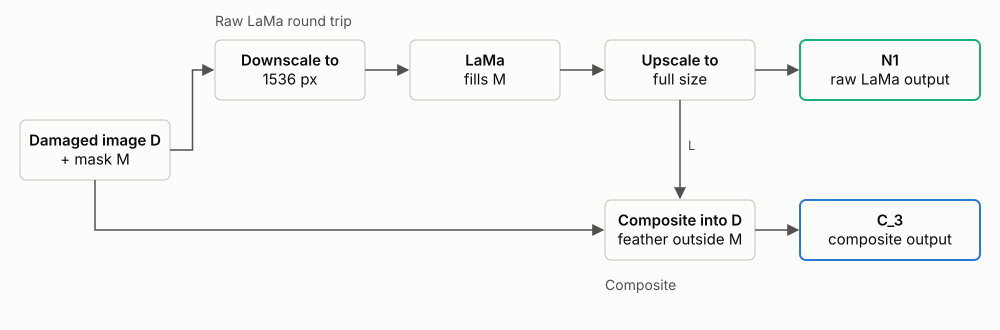

<!-- WRITE: caption for Figure F -->

## Compositing, and the bug I found in it

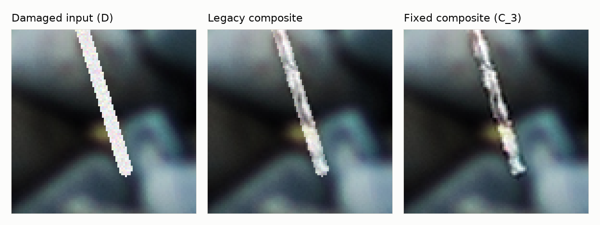

<!-- WRITE: caption for Figure C -->

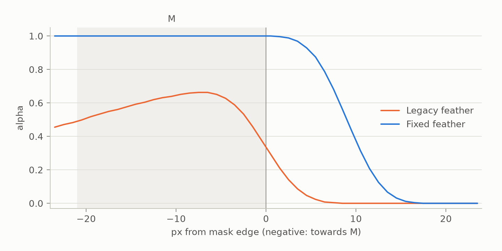

<!-- WRITE: caption for the alpha profile -->

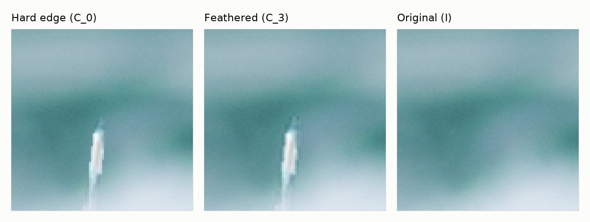

<!-- WRITE: caption for Figure D -->

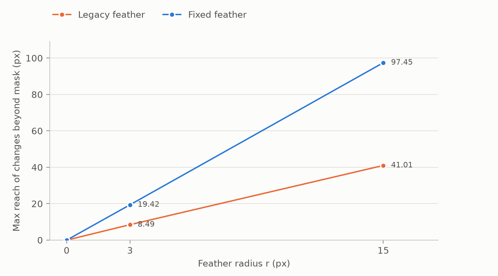

<!-- WRITE: caption for chart 4 -->

## How I measured it

<!-- WRITE: how I measured it -->

## Results

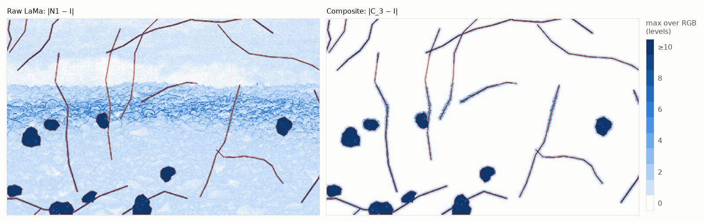

[Full-resolution change maps](figures/fig_a_change_maps_full.png)

<!-- WRITE: caption for Figure A -->

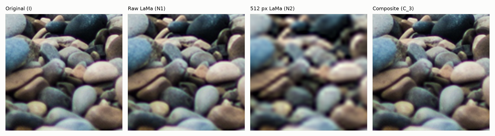

<!-- WRITE: caption for Figure B -->

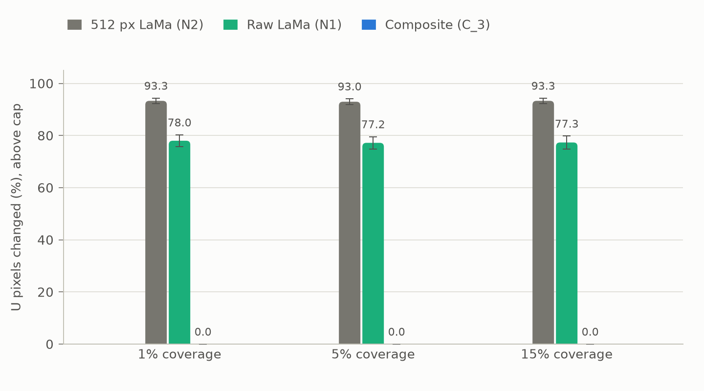

<!-- WRITE: caption for chart 1 -->

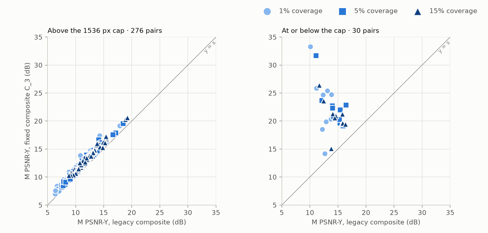

<!-- WRITE: caption for chart 2 -->

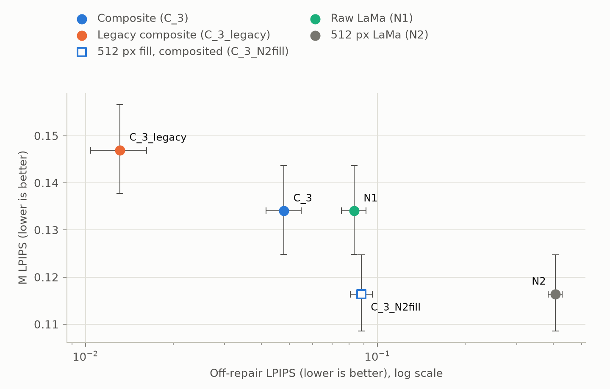

<!-- WRITE: caption for chart 3 -->

<!-- BEGIN headline -->

| Metric | Condition | Above cap, 1% | Above cap, 5% | Above cap, 15% | At or below cap, 1% | At or below cap, 5% | At or below cap, 15% |
|---|---|---:|---:|---:|---:|---:|---:|
| **Pairs (u_empty)** |  | 92 (0) | 92 (0) | 92 (0) | 10 (0) | 10 (0) | 10 (2) |
| U changed (%) | N1 | 78.01 [75.69, 80.27] | 77.20 [74.77, 79.57] | 77.34 [74.77, 79.80] | 0.00 [0.00, 0.00] | 0.00 [0.00, 0.00] | 0.00 [0.00, 0.00] (n = 8) |
| U changed (%) | N2 | 93.31 [92.21, 94.35] | 92.97 [91.79, 94.08] | 93.31 [92.22, 94.35] | 85.20 [65.45, 97.34] | 86.18 [66.44, 97.51] | 96.67 [94.86, 98.39] (n = 8) |
| U changed (%) | C_3 | 0.00 [0.00, 0.00] | 0.00 [0.00, 0.00] | 0.00 [0.00, 0.00] | 0.00 [0.00, 0.00] | 0.00 [0.00, 0.00] | 0.00 [0.00, 0.00] (n = 8) |
| U changed by >1 level (%) | N1 | 36.68 [33.40, 40.02] | 35.61 [32.27, 39.00] | 34.90 [31.51, 38.36] | 0.00 [0.00, 0.00] | 0.00 [0.00, 0.00] | 0.00 [0.00, 0.00] (n = 8) |
| U changed by >1 level (%) | N2 | 70.25 [67.75, 72.72] | 69.17 [66.55, 71.80] | 69.09 [66.34, 71.83] | 69.56 [51.61, 83.35] | 71.00 [53.71, 83.17] | 79.40 [71.15, 87.40] (n = 8) |
| U changed by >1 level (%) | C_3 | 0.00 [0.00, 0.00] | 0.00 [0.00, 0.00] | 0.00 [0.00, 0.00] | 0.00 [0.00, 0.00] | 0.00 [0.00, 0.00] | 0.00 [0.00, 0.00] (n = 8) |
| M PSNR-Y (dB) | C_3_legacy | 10.19 [9.78, 10.61] | 10.92 [10.51, 11.37] | 12.11 [11.74, 12.50] | 12.62 [11.84, 13.32] | 14.36 [13.33, 15.28] | 14.46 [13.54, 15.32] |
| M PSNR-Y (dB) | C_3 | 11.37 [10.93, 11.83] | 12.03 [11.59, 12.51] | 13.35 [12.97, 13.77] | 22.94 [19.97, 26.04] | 22.54 [20.82, 24.86] | 20.76 [19.02, 22.51] |
| M PSNR-Y (dB) | C_3_N2fill | 12.57 [12.11, 13.07] | 12.74 [12.30, 13.21] | 14.56 [14.21, 14.95] | 14.72 [11.86, 19.13] | 15.39 [12.83, 19.32] | 15.58 [13.90, 18.18] |
| Off-repair LPIPS | C_3_legacy | 0.0034 [0.0026, 0.0043] | 0.0131 [0.0104, 0.0162] | 0.0338 [0.0276, 0.0409] | 0.0000 [0.0000, 0.0000] | 0.0000 [0.0000, 0.0000] | 0.0000 [0.0000, 0.0000] |
| Off-repair LPIPS | C_3 | 0.0130 [0.0111, 0.0150] | 0.0479 [0.0415, 0.0549] | 0.1082 [0.0950, 0.1228] | 0.0000 [0.0000, 0.0000] | 0.0000 [0.0000, 0.0000] | 0.0000 [0.0000, 0.0000] |
| Off-repair LPIPS | C_3_N2fill | 0.0240 [0.0217, 0.0264] | 0.0882 [0.0808, 0.0962] | 0.1908 [0.1765, 0.2064] | 0.0139 [0.0096, 0.0178] | 0.0507 [0.0370, 0.0619] | 0.1086 [0.0782, 0.1349] |
| Off-repair LPIPS | N1 | 0.0519 [0.0464, 0.0577] | 0.0833 [0.0753, 0.0915] | 0.1361 [0.1226, 0.1506] | 0.0000 [0.0000, 0.0000] | 0.0000 [0.0000, 0.0000] | 0.0000 [0.0000, 0.0000] |
| Off-repair LPIPS | N2 | 0.3818 [0.3580, 0.4063] | 0.4063 [0.3842, 0.4289] | 0.4334 [0.4145, 0.4534] | 0.2787 [0.1941, 0.3605] | 0.2861 [0.2013, 0.3663] | 0.2841 [0.2021, 0.3604] |

<!-- END headline -->

<!-- WRITE: note on the headline table -->

<!-- BEGIN paired -->

| Size class | Coverage | Comparison (a − b) | Metric | Mean difference [95% CI] | a better / equal / worse | n |
|---|---:|---|---|---:|---:|---:|
| Above cap | 1% | C_3 − C_3_legacy | M PSNR-Y (dB) | +1.183 [+1.090, +1.285] | 92 / 0 / 0 | 92 |
| Above cap | 1% | C_3 − C_3_legacy | M LPIPS | -0.0038 [-0.0041, -0.0034] | 92 / 0 / 0 | 92 |
| Above cap | 1% | C_3 − C_3_legacy | Off-repair LPIPS | +0.0096 [+0.0084, +0.0108] | 0 / 0 / 92 | 92 |
| Above cap | 1% | C_3 − N1 | M PSNR-Y (dB) | +0.000 [+0.000, +0.000] | 0 / 92 / 0 | 92 |
| Above cap | 1% | C_3 − N1 | M LPIPS | +0.0000 [+0.0000, +0.0000] | 0 / 92 / 0 | 92 |
| Above cap | 1% | C_3 − N1 | U mean abs diff | -1.618 [-1.857, -1.405] | 92 / 0 / 0 | 92 |
| Above cap | 1% | C_3 − N2 | M PSNR-Y (dB) | -1.202 [-1.468, -0.931] | 15 / 0 / 77 | 92 |
| Above cap | 1% | C_3 − N2 | M LPIPS | +0.0060 [+0.0051, +0.0069] | 6 / 0 / 86 | 92 |
| Above cap | 1% | C_3 − N2 | U mean abs diff | -5.121 [-5.788, -4.511] | 92 / 0 / 0 | 92 |
| Above cap | 1% | C_3_N2fill − C_3 | M PSNR-Y (dB) | +1.202 [+0.931, +1.468] | 77 / 0 / 15 | 92 |
| Above cap | 1% | C_3_N2fill − C_3 | M LPIPS | -0.0060 [-0.0069, -0.0051] | 86 / 0 / 6 | 92 |
| Above cap | 1% | C_3_N2fill − C_3 | Off-repair LPIPS | +0.0110 [+0.0102, +0.0118] | 0 / 0 / 92 | 92 |
| Above cap | 1% | C_3_N2fill − N2 | M PSNR-Y (dB) | +0.000 [+0.000, +0.000] | 0 / 92 / 0 | 92 |
| Above cap | 1% | C_3_N2fill − N2 | M LPIPS | +0.0000 [+0.0000, +0.0000] | 0 / 92 / 0 | 92 |
| Above cap | 1% | C_3_N2fill − N2 | Off-repair LPIPS | -0.3578 [-0.3828, -0.3336] | 92 / 0 / 0 | 92 |
| Above cap | 5% | C_3 − C_3_legacy | M PSNR-Y (dB) | +1.106 [+1.028, +1.187] | 92 / 0 / 0 | 92 |
| Above cap | 5% | C_3 − C_3_legacy | M LPIPS | -0.0129 [-0.0141, -0.0119] | 92 / 0 / 0 | 92 |
| Above cap | 5% | C_3 − C_3_legacy | Off-repair LPIPS | +0.0348 [+0.0308, +0.0391] | 0 / 0 / 92 | 92 |
| Above cap | 5% | C_3 − N1 | M PSNR-Y (dB) | +0.000 [+0.000, +0.000] | 0 / 92 / 0 | 92 |
| Above cap | 5% | C_3 − N1 | M LPIPS | +0.0000 [+0.0000, +0.0000] | 0 / 92 / 0 | 92 |
| Above cap | 5% | C_3 − N1 | U mean abs diff | -1.565 [-1.797, -1.356] | 92 / 0 / 0 | 92 |
| Above cap | 5% | C_3 − N2 | M PSNR-Y (dB) | -0.714 [-0.919, -0.508] | 20 / 0 / 72 | 92 |
| Above cap | 5% | C_3 − N2 | M LPIPS | +0.0177 [+0.0152, +0.0200] | 6 / 0 / 86 | 92 |
| Above cap | 5% | C_3 − N2 | U mean abs diff | -4.952 [-5.612, -4.327] | 92 / 0 / 0 | 92 |
| Above cap | 5% | C_3_N2fill − C_3 | M PSNR-Y (dB) | +0.714 [+0.508, +0.919] | 72 / 0 / 20 | 92 |
| Above cap | 5% | C_3_N2fill − C_3 | M LPIPS | -0.0177 [-0.0200, -0.0152] | 86 / 0 / 6 | 92 |
| Above cap | 5% | C_3_N2fill − C_3 | Off-repair LPIPS | +0.0403 [+0.0376, +0.0431] | 0 / 0 / 92 | 92 |
| Above cap | 5% | C_3_N2fill − N2 | M PSNR-Y (dB) | +0.000 [+0.000, +0.000] | 0 / 92 / 0 | 92 |
| Above cap | 5% | C_3_N2fill − N2 | M LPIPS | +0.0000 [+0.0000, +0.0000] | 0 / 92 / 0 | 92 |
| Above cap | 5% | C_3_N2fill − N2 | Off-repair LPIPS | -0.3182 [-0.3408, -0.2961] | 92 / 0 / 0 | 92 |
| Above cap | 15% | C_3 − C_3_legacy | M PSNR-Y (dB) | +1.246 [+1.174, +1.319] | 92 / 0 / 0 | 92 |
| Above cap | 15% | C_3 − C_3_legacy | M LPIPS | -0.0250 [-0.0269, -0.0234] | 92 / 0 / 0 | 92 |
| Above cap | 15% | C_3 − C_3_legacy | Off-repair LPIPS | +0.0744 [+0.0667, +0.0827] | 0 / 0 / 92 | 92 |
| Above cap | 15% | C_3 − N1 | M PSNR-Y (dB) | +0.000 [+0.000, +0.000] | 0 / 92 / 0 | 92 |
| Above cap | 15% | C_3 − N1 | M LPIPS | +0.0000 [+0.0000, +0.0000] | 0 / 92 / 0 | 92 |
| Above cap | 15% | C_3 − N1 | U mean abs diff | -1.458 [-1.666, -1.273] | 92 / 0 / 0 | 92 |
| Above cap | 15% | C_3 − N2 | M PSNR-Y (dB) | -1.210 [-1.382, -1.042] | 2 / 0 / 90 | 92 |
| Above cap | 15% | C_3 − N2 | M LPIPS | +0.0257 [+0.0210, +0.0302] | 9 / 0 / 83 | 92 |
| Above cap | 15% | C_3 − N2 | U mean abs diff | -4.611 [-5.234, -4.038] | 92 / 0 / 0 | 92 |
| Above cap | 15% | C_3_N2fill − C_3 | M PSNR-Y (dB) | +1.210 [+1.042, +1.382] | 90 / 0 / 2 | 92 |
| Above cap | 15% | C_3_N2fill − C_3 | M LPIPS | -0.0257 [-0.0302, -0.0210] | 83 / 0 / 9 | 92 |
| Above cap | 15% | C_3_N2fill − C_3 | Off-repair LPIPS | +0.0825 [+0.0774, +0.0878] | 0 / 0 / 92 | 92 |
| Above cap | 15% | C_3_N2fill − N2 | M PSNR-Y (dB) | +0.000 [+0.000, +0.000] | 0 / 92 / 0 | 92 |
| Above cap | 15% | C_3_N2fill − N2 | M LPIPS | +0.0000 [+0.0000, +0.0000] | 0 / 92 / 0 | 92 |
| Above cap | 15% | C_3_N2fill − N2 | Off-repair LPIPS | -0.2426 [-0.2610, -0.2248] | 92 / 0 / 0 | 92 |
| At or below cap | 1% | C_3 − C_3_legacy | M PSNR-Y (dB) | +10.319 [+7.040, +14.008] | 10 / 0 / 0 | 10 |
| At or below cap | 1% | C_3 − C_3_legacy | M LPIPS | -0.0327 [-0.0471, -0.0215] | 10 / 0 / 0 | 10 |
| At or below cap | 1% | C_3 − C_3_legacy | Off-repair LPIPS | +0.0000 [+0.0000, +0.0000] | 0 / 10 / 0 | 10 |
| At or below cap | 1% | C_3 − N1 | M PSNR-Y (dB) | +0.000 [+0.000, +0.000] | 0 / 10 / 0 | 10 |
| At or below cap | 1% | C_3 − N1 | M LPIPS | +0.0000 [+0.0000, +0.0000] | 0 / 10 / 0 | 10 |
| At or below cap | 1% | C_3 − N1 | U mean abs diff | +0.000 [+0.000, +0.000] | 0 / 10 / 0 | 10 |
| At or below cap | 1% | C_3 − N2 | M PSNR-Y (dB) | +8.214 [+5.135, +11.277] | 9 / 1 / 0 | 10 |
| At or below cap | 1% | C_3 − N2 | M LPIPS | -0.0207 [-0.0286, -0.0135] | 9 / 1 / 0 | 10 |
| At or below cap | 1% | C_3 − N2 | U mean abs diff | -5.667 [-7.027, -4.126] | 9 / 1 / 0 | 10 |
| At or below cap | 1% | C_3_N2fill − C_3 | M PSNR-Y (dB) | -8.214 [-11.277, -5.135] | 0 / 1 / 9 | 10 |
| At or below cap | 1% | C_3_N2fill − C_3 | M LPIPS | +0.0207 [+0.0135, +0.0286] | 0 / 1 / 9 | 10 |
| At or below cap | 1% | C_3_N2fill − C_3 | Off-repair LPIPS | +0.0139 [+0.0096, +0.0178] | 0 / 1 / 9 | 10 |
| At or below cap | 1% | C_3_N2fill − N2 | M PSNR-Y (dB) | +0.000 [+0.000, +0.000] | 0 / 10 / 0 | 10 |
| At or below cap | 1% | C_3_N2fill − N2 | M LPIPS | +0.0000 [+0.0000, +0.0000] | 0 / 10 / 0 | 10 |
| At or below cap | 1% | C_3_N2fill − N2 | Off-repair LPIPS | -0.2648 [-0.3435, -0.1837] | 9 / 1 / 0 | 10 |
| At or below cap | 5% | C_3 − C_3_legacy | M PSNR-Y (dB) | +8.175 [+5.734, +11.431] | 10 / 0 / 0 | 10 |
| At or below cap | 5% | C_3 − C_3_legacy | M LPIPS | -0.1091 [-0.1438, -0.0828] | 10 / 0 / 0 | 10 |
| At or below cap | 5% | C_3 − C_3_legacy | Off-repair LPIPS | +0.0000 [+0.0000, +0.0000] | 0 / 10 / 0 | 10 |
| At or below cap | 5% | C_3 − N1 | M PSNR-Y (dB) | +0.000 [+0.000, +0.000] | 0 / 10 / 0 | 10 |
| At or below cap | 5% | C_3 − N1 | M LPIPS | +0.0000 [+0.0000, +0.0000] | 0 / 10 / 0 | 10 |
| At or below cap | 5% | C_3 − N1 | U mean abs diff | +0.000 [+0.000, +0.000] | 0 / 10 / 0 | 10 |
| At or below cap | 5% | C_3 − N2 | M PSNR-Y (dB) | +7.151 [+4.962, +9.219] | 9 / 1 / 0 | 10 |
| At or below cap | 5% | C_3 − N2 | M LPIPS | -0.0798 [-0.1004, -0.0575] | 9 / 1 / 0 | 10 |
| At or below cap | 5% | C_3 − N2 | U mean abs diff | -5.866 [-7.448, -4.121] | 9 / 1 / 0 | 10 |
| At or below cap | 5% | C_3_N2fill − C_3 | M PSNR-Y (dB) | -7.151 [-9.219, -4.962] | 0 / 1 / 9 | 10 |
| At or below cap | 5% | C_3_N2fill − C_3 | M LPIPS | +0.0798 [+0.0575, +0.1004] | 0 / 1 / 9 | 10 |
| At or below cap | 5% | C_3_N2fill − C_3 | Off-repair LPIPS | +0.0507 [+0.0370, +0.0619] | 0 / 1 / 9 | 10 |
| At or below cap | 5% | C_3_N2fill − N2 | M PSNR-Y (dB) | +0.000 [+0.000, +0.000] | 0 / 10 / 0 | 10 |
| At or below cap | 5% | C_3_N2fill − N2 | M LPIPS | +0.0000 [+0.0000, +0.0000] | 0 / 10 / 0 | 10 |
| At or below cap | 5% | C_3_N2fill − N2 | Off-repair LPIPS | -0.2354 [-0.3072, -0.1626] | 9 / 1 / 0 | 10 |
| At or below cap | 15% | C_3 − C_3_legacy | M PSNR-Y (dB) | +6.297 [+4.163, +8.806] | 10 / 0 / 0 | 10 |
| At or below cap | 15% | C_3 − C_3_legacy | M LPIPS | -0.2044 [-0.2585, -0.1592] | 10 / 0 / 0 | 10 |
| At or below cap | 15% | C_3 − C_3_legacy | Off-repair LPIPS | +0.0000 [+0.0000, +0.0000] | 0 / 10 / 0 | 10 |
| At or below cap | 15% | C_3 − N1 | M PSNR-Y (dB) | +0.000 [+0.000, +0.000] | 0 / 10 / 0 | 10 |
| At or below cap | 15% | C_3 − N1 | M LPIPS | +0.0000 [+0.0000, +0.0000] | 0 / 10 / 0 | 10 |
| At or below cap | 15% | C_3 − N1 | U mean abs diff | +0.000 [+0.000, +0.000] | 0 / 8 / 0 | 8 (2 u_empty excluded) |
| At or below cap | 15% | C_3 − N2 | M PSNR-Y (dB) | +5.179 [+3.330, +6.959] | 9 / 1 / 0 | 10 |
| At or below cap | 15% | C_3 − N2 | M LPIPS | -0.1609 [-0.2019, -0.1162] | 9 / 1 / 0 | 10 |
| At or below cap | 15% | C_3 − N2 | U mean abs diff | -6.977 [-10.359, -4.331] | 8 / 0 / 0 | 8 (2 u_empty excluded) |
| At or below cap | 15% | C_3_N2fill − C_3 | M PSNR-Y (dB) | -5.179 [-6.959, -3.330] | 0 / 1 / 9 | 10 |
| At or below cap | 15% | C_3_N2fill − C_3 | M LPIPS | +0.1609 [+0.1162, +0.2019] | 0 / 1 / 9 | 10 |
| At or below cap | 15% | C_3_N2fill − C_3 | Off-repair LPIPS | +0.1086 [+0.0782, +0.1349] | 0 / 1 / 9 | 10 |
| At or below cap | 15% | C_3_N2fill − N2 | M PSNR-Y (dB) | +0.000 [+0.000, +0.000] | 0 / 10 / 0 | 10 |
| At or below cap | 15% | C_3_N2fill − N2 | M LPIPS | +0.0000 [+0.0000, +0.0000] | 0 / 10 / 0 | 10 |
| At or below cap | 15% | C_3_N2fill − N2 | Off-repair LPIPS | -0.1755 [-0.2310, -0.1194] | 9 / 1 / 0 | 10 |

<!-- END paired -->

<!-- WRITE: note on the paired table -->

## A fix that only half worked

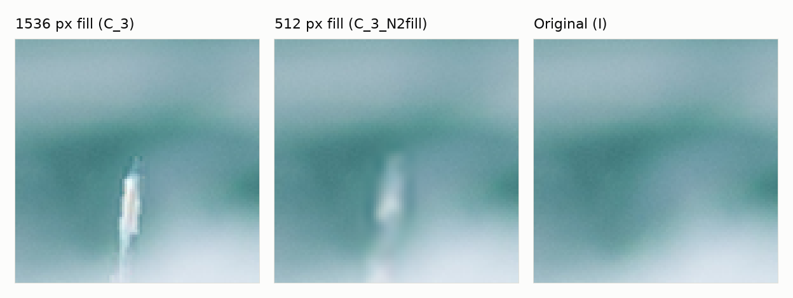

<!-- WRITE: caption for Figure E -->

## The upscaler bug

<!-- BEGIN upscaler -->

| Method (10 Mobile crops, 512×512) | PSNR-Y (dB) mean | min | max | SSIM-Y mean | min | max | LPIPS mean | min | max |
|---|---:|---:|---:|---:|---:|---:|---:|---:|---:|
| Bicubic | 29.97 | 24.86 | 37.48 | 0.7967 | 0.6140 | 0.9074 | 0.4682 | 0.3137 | 0.6745 |
| Real-ESRGAN, old path | 28.88 | 23.13 | 38.61 | 0.7940 | 0.5628 | 0.9550 | 0.2099 | 0.1254 | 0.3059 |
| Real-ESRGAN, fixed path | 30.28 | 24.82 | 39.09 | 0.8320 | 0.6125 | 0.9586 | 0.1843 | 0.1237 | 0.2347 |

<!-- END upscaler -->

<!-- WRITE: the upscaler bug -->

## Limitations and what I would do next

<!-- WRITE: limitations and what I would do next -->

## Reproducing this

```bash
python3.11 -m venv venv
./venv/bin/pip install -r requirements.txt -r requirements-dev.txt
./venv/bin/pip install --no-deps pyiqa==0.1.15.post2
./venv/bin/pip install timm==1.0.27 openai-clip==1.0.1 ftfy==6.3.1 regex==2026.5.9 requests==2.34.2
```

```bash
./venv/bin/python -I scripts/fetch_data.py
```

```bash
./venv/bin/python scripts/run_compositing_experiment.py --preflight-only
./venv/bin/python scripts/run_compositing_experiment.py --out results/compositing_repro
```

```bash
./venv/bin/python scripts/summarise_compositing.py --dir results/compositing_repro
```

Make the figures and tables (from the committed results in results/compositing/):

```bash
./venv/bin/python scripts/make_figures.py
./venv/bin/python scripts/make_tables.py
```

## Credits

<!-- BEGIN credits -->

| Image | Split | Licence | Licence source | Dataset source |
|---|---|---|---|---|
| jeremy-cai-1174.png | professional | Unsplash License | <https://data.vision.ee.ethz.ch/cvl/clic/LICENSE_professional_2020.txt> | <https://downloads.compression.cc/clic2020_professional_valid.zip> |

<!-- END credits -->
