# What a LaMa repair changes outside the mask

## Summary

On the 92 test photos larger than my app's 1536 px inpainting size, raw LaMa output changed on average 77.20 to 78.01% of the pixels far from any repair. Pasting only the fill back into the original, with a soft edge, changed none of them. Moving that soft edge outside the mask raised repair PSNR-Y on all 92 images, by a mean of 1.106 to 1.246 dB, at a measurable cost just beyond the mask. A separate fix to how Real-ESRGAN makes 2x output improved its mean PSNR-Y, SSIM-Y and LPIPS on 10 test crops.

## Motivation

My app's Brush Repair tab runs LaMa on a copy of the photo whose long edge is at most 1536 px. Larger photos are shrunk to that size, and the result is enlarged back. Every pixel goes through that round trip, including pixels the user never touched.

A user who brushes over one scratch expects the rest of the photo to stay as it was. Resampling breaks that expectation in a way that is hard to see but easy to measure.

The usual answer is to paste only the repaired region back into the full-resolution original. I wanted to measure how well that works in my implementation, and what its soft edge costs.

## Related work and what this project adds

The models come from other authors. LaMa, by Suvorov et al. [1], fills large masks using fast Fourier convolutions. Real-ESRGAN, by Wang et al. [2], restores and upscales degraded photos, and CodeFormer, by Zhou et al. [3], restores faces. I run LaMa through simple-lama-inpainting [4] and load the other two with spandrel [5].

Pasting an inpainted region back at full resolution is an established technique. [IOPaint](https://github.com/Sanster/IOPaint) [6], formerly Lama Cleaner, offers it as its **Resize** strategy, the same idea my compositing follows. Resize shrinks the image for inpainting and enlarges the result back, so the area outside the mask keeps its quality. Its **Crop** strategy instead inpaints a crop of the masked area, with a margin, at the original resolution.

What this project adds is measurement. I test the paste-back on 306 image and mask pairs with synthetic damage and report what changes in each region. The measurements exposed a defect in my own feathering, which I fixed. They also exposed a dependence on the damage colour above the resize cap, which is still open.

## Pipeline overview

Auto Restore routes faces to CodeFormer and blur, noise or low resolution to Real-ESRGAN. Brush Repair sends a user-drawn mask to LaMa, and Benchmark scores restorations of synthetically degraded images.

This write-up is mostly about Brush Repair, whose two paths Figure F shows. The raw path returns LaMa's output after the round trip through 1536 px. The composite path blends that output into the damaged input with a soft mask, so only the mask and a thin band around it can change.

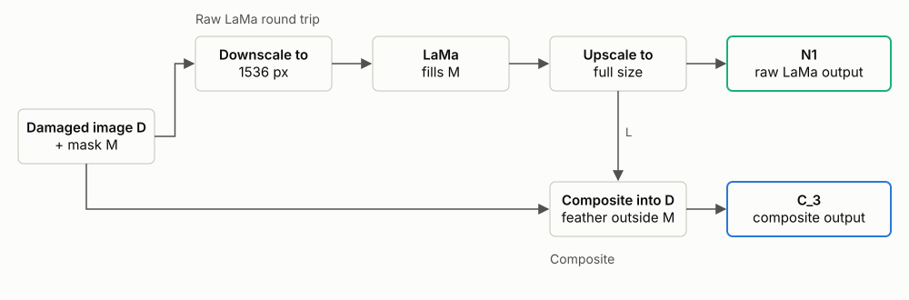

*Figure F. The two Brush Repair paths compared in this write-up. N1 is LaMa's output after the round trip; C_3 is that output composited into the damaged image with the feather outside the mask.*

## How the evaluation works

I use the validation set of CLIC 2020 [7]: 102 photos, 61 from its Mobile split and 41 from its Professional split. Their long edges run from 512 to 2048 px. Of these, 92 are larger than the 1536 px cap and 10 are not, so I report the two groups separately.

For each image I draw seeded masks at 1%, 5% and 15% coverage, which gives 306 pairs. Each mask mixes thin strokes with filled blobs. Inside the mask I overwrite the pixels with a bright fill of 235 plus Gaussian noise with a standard deviation of 10, giving the damaged image D.

From each pair I build eight outputs. N1 is raw LaMa at the 1536 px cap, and N2 is raw LaMa with the cap lowered to 512 px.

C_0, C_3 and C_15 composite N1's fill into D with my current feather, at blur radius 0, 3 and 15. C_3_legacy and C_15_legacy use my earlier feather, which was centred on the mask edge. C_3_N2fill composites the 512 px fill with the current radius 3 feather.

I score three regions against the clean original I. M is the mask itself, and H is the halo: the pixels outside M that a given feather reaches. The untouched region **U** is every pixel beyond the widest feather I test, radius 15, so a correct composite must leave it unchanged.

At 15% coverage U becomes small, and for two of the 10 smaller images it is empty. I leave those two pairs out of the U averages.

In U I count the share of pixels where any colour channel changed, and the share that changed by more than one level. In M I report PSNR-Y on BT.601 luma [9] and LPIPS [10], with LPIPS from pyiqa [11]. M LPIPS compares I with an image that holds the output inside M and I everywhere else. Off-repair LPIPS does the reverse, so it scores only what an output did to the rest of the photo.

Every mean comes with a 95% percentile bootstrap interval from 10,000 resamples of images, with seed 0. For comparisons between two outputs I bootstrap the per-image differences and count the images that got better, stayed equal or got worse.

## Observations

### What compositing guarantees: untouched pixels

Above the cap, raw LaMa changed on average 78.01%, 77.20% and 77.34% of U at 1%, 5% and 15% coverage. Many of these changes are a single level. Only 34.90 to 36.68% of U pixels moved by more than one level, and the mean absolute change per channel was 1.458 to 1.618 levels.

Lowering the cap to 512 px made this worse. N2 changed 92.97 to 93.31% of U, with 69.09 to 70.25% of U moving by more than one level. Every composite left every U pixel unchanged in all 306 pairs, apart from the two pairs with an empty U.

Below the cap there is no round trip, and raw LaMa also left U unchanged in all 10 images. That points to the resampling, not to LaMa itself, as the source of the changes outside the mask.

The figures use one Professional photo above the cap, chosen by a fixed rule. Of those photos, its raw LaMa U change at 5% coverage, 79.89%, is the closest to the median of all 92 images, 79.32%.

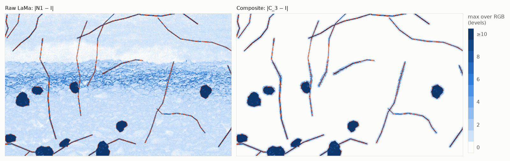

[Full-resolution change maps](figures/fig_a_change_maps_full.png)

*Figure A. Absolute change from the original at 5% coverage, with the mask outlined. Raw LaMa changes pixels across the whole frame, most strongly in textured areas; the composite changes only the mask and a narrow band around it.*

Figure B takes a 128 px window from U at the 90th percentile of image detail. At 4x the raw LaMa crop is hard to tell from the original, while the 512 px crop is visibly blurred.

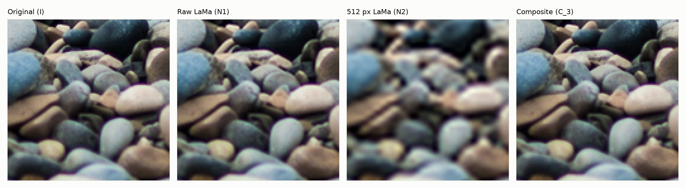

*Figure B. A 128 px crop from U at 4x: original, raw LaMa, 512 px LaMa and composite. Of its 16,384 pixels, raw LaMa changed 15,272, 512 px LaMa changed 16,344 and the composite changed none.*

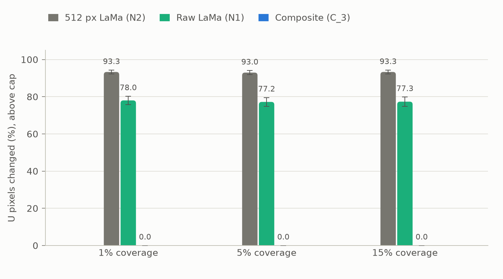

*Chart 1. Share of U pixels changed by each output above the cap, with 95% intervals. The composite's bars sit at zero for every coverage.*

The headline table collects these numbers for both size classes. Below the cap N2 still changes 85.20 to 96.67% of U, because a 512 px cap resamples all but one of those images.

<!-- BEGIN headline -->

| Metric | Condition | Above cap, 1% | Above cap, 5% | Above cap, 15% | At or below cap, 1% | At or below cap, 5% | At or below cap, 15% |
|---|---|---:|---:|---:|---:|---:|---:|
| **Pairs (u_empty)** |  | 92 (0) | 92 (0) | 92 (0) | 10 (0) | 10 (0) | 10 (2) |
| U changed (%) | N1 | 78.01 [75.69, 80.27] | 77.20 [74.77, 79.57] | 77.34 [74.77, 79.80] | 0.00 [0.00, 0.00] | 0.00 [0.00, 0.00] | 0.00 [0.00, 0.00] (n = 8) |
| U changed (%) | N2 | 93.31 [92.21, 94.35] | 92.97 [91.79, 94.08] | 93.31 [92.22, 94.35] | 85.20 [65.45, 97.34] | 86.18 [66.44, 97.51] | 96.67 [94.86, 98.39] (n = 8) |
| U changed (%) | C_3 | 0.00 [0.00, 0.00] | 0.00 [0.00, 0.00] | 0.00 [0.00, 0.00] | 0.00 [0.00, 0.00] | 0.00 [0.00, 0.00] | 0.00 [0.00, 0.00] (n = 8) |
| U changed by >1 level (%) | N1 | 36.68 [33.40, 40.02] | 35.61 [32.27, 39.00] | 34.90 [31.51, 38.36] | 0.00 [0.00, 0.00] | 0.00 [0.00, 0.00] | 0.00 [0.00, 0.00] (n = 8) |
| U changed by >1 level (%) | N2 | 70.25 [67.75, 72.72] | 69.17 [66.55, 71.80] | 69.09 [66.34, 71.83] | 69.56 [51.61, 83.35] | 71.00 [53.71, 83.17] | 79.40 [71.15, 87.40] (n = 8) |
| U changed by >1 level (%) | C_3 | 0.00 [0.00, 0.00] | 0.00 [0.00, 0.00] | 0.00 [0.00, 0.00] | 0.00 [0.00, 0.00] | 0.00 [0.00, 0.00] | 0.00 [0.00, 0.00] (n = 8) |
| M PSNR-Y (dB) | C_3_legacy | 10.19 [9.78, 10.61] | 10.92 [10.51, 11.37] | 12.11 [11.74, 12.50] | 12.62 [11.84, 13.32] | 14.36 [13.33, 15.28] | 14.46 [13.54, 15.32] |
| M PSNR-Y (dB) | C_3 | 11.37 [10.93, 11.83] | 12.03 [11.59, 12.51] | 13.35 [12.97, 13.77] | 22.94 [19.97, 26.04] | 22.54 [20.82, 24.86] | 20.76 [19.02, 22.51] |
| M PSNR-Y (dB) | C_3_N2fill | 12.57 [12.11, 13.07] | 12.74 [12.30, 13.21] | 14.56 [14.21, 14.95] | 14.72 [11.86, 19.13] | 15.39 [12.83, 19.32] | 15.58 [13.90, 18.18] |
| Off-repair LPIPS | C_3_legacy | 0.0034 [0.0026, 0.0043] | 0.0131 [0.0104, 0.0162] | 0.0338 [0.0276, 0.0409] | 0.0000 [0.0000, 0.0000] | 0.0000 [0.0000, 0.0000] | 0.0000 [0.0000, 0.0000] |
| Off-repair LPIPS | C_3 | 0.0130 [0.0111, 0.0150] | 0.0479 [0.0415, 0.0549] | 0.1082 [0.0950, 0.1228] | 0.0000 [0.0000, 0.0000] | 0.0000 [0.0000, 0.0000] | 0.0000 [0.0000, 0.0000] |
| Off-repair LPIPS | C_3_N2fill | 0.0240 [0.0217, 0.0264] | 0.0882 [0.0808, 0.0962] | 0.1908 [0.1765, 0.2064] | 0.0139 [0.0096, 0.0178] | 0.0507 [0.0370, 0.0619] | 0.1086 [0.0782, 0.1349] |
| Off-repair LPIPS | N1 | 0.0519 [0.0464, 0.0577] | 0.0833 [0.0753, 0.0915] | 0.1361 [0.1226, 0.1506] | 0.0000 [0.0000, 0.0000] | 0.0000 [0.0000, 0.0000] | 0.0000 [0.0000, 0.0000] |
| Off-repair LPIPS | N2 | 0.3818 [0.3580, 0.4063] | 0.4063 [0.3842, 0.4289] | 0.4334 [0.4145, 0.4534] | 0.2787 [0.1941, 0.3605] | 0.2861 [0.2013, 0.3663] | 0.2841 [0.2021, 0.3604] |

<!-- END headline -->

### Refining the feathered edge

My first compositing code blurred the mask with a Gaussian centred on the mask edge. That puts part of the soft ramp inside the mask, so pixels near the inner edge keep part of the damaged fill. The current code first dilates the mask by the blur's reach, then blurs it. Alpha is then exactly 1 on every mask pixel, and the whole ramp lies outside M.

Pillow's Gaussian blur is an extended box filter [8] with a finite footprint. I measure its effective reach as 8 px at radius 3 and 40 px at radius 15.

Above the cap, the legacy radius 3 feather gave the damaged pixels a mean weight inside M of 0.2236, 0.1758 and 0.1466. The legacy radius 15 feather gave them 0.6034, 0.4391 and 0.3467. Every composite with the current feather gives them a weight of 0.

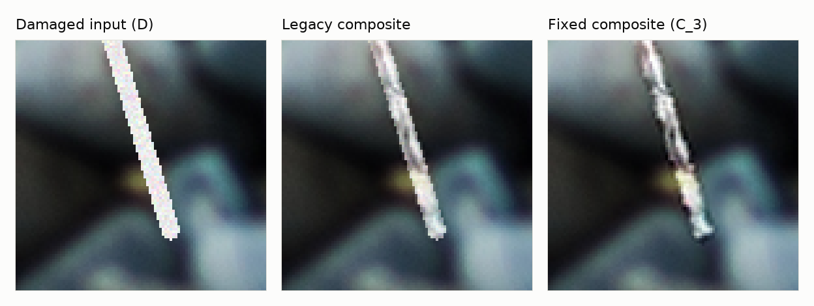

*Figure C. A mask edge at 4x: damaged input, legacy composite and current composite. The legacy result keeps a pale, see-through trace of the fill; the current one shows LaMa's own fill, which is crisper but still a visible pale streak here.*

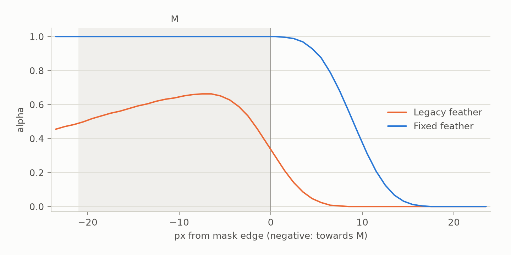

*Figure C, alpha profile. Alpha along a line across the Figure C edge. The legacy alpha peaks at 0.663 inside the mask and drops to 0.376 at its inner edge, while the current alpha is 1 across the mask and falls to 0 by 17.5 px outside it.*

Inside M the fix raised PSNR-Y in all 306 pairs. Above the cap the mean gain was 1.183, 1.106 and 1.246 dB, with all 92 images better at each coverage. Below the cap the gain was 10.319, 8.175 and 6.297 dB.

Two measured differences fit the larger gain below the cap. The legacy feather gave the damaged pixels more weight there, 0.3509, 0.2624 and 0.2138. The fill was also closer to the original: below the cap C_3 scores 20.76 to 22.94 dB inside M, against 11.37 to 13.35 dB above it.

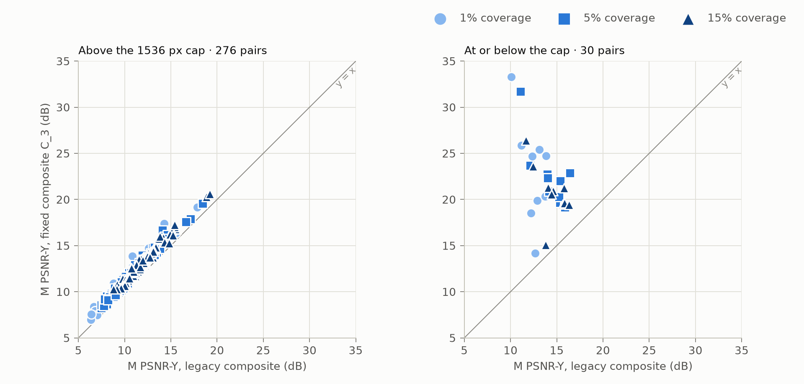

*Chart 2. M PSNR-Y of the legacy composite against the current one, per image and coverage, above and below the cap. All 306 points lie above the y = x line.*

The fix moves the soft edge onto pixels that the old feather left alone. On the test images, the current radius 3 feather reaches 19.42 px beyond the mask, against 8.49 px for the legacy one. Above the cap those pixels take part of LaMa's round-tripped output, so off-repair LPIPS rose by 0.0096, 0.0348 and 0.0744. It was worse for all 92 images at each coverage.

Below the cap, no halo pixel changed under either feather, and off-repair LPIPS stayed at 0.

Figure D compares a hard edge with the radius 3 feather at the Figure C location. I see no clear seam in either, so at this edge the feather adds little visible benefit. One edge is not a general test of seams.

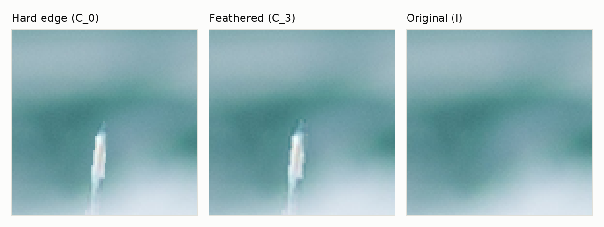

*Figure D. The Figure C edge with a hard composite (radius 0), the radius 3 feather and the original. At this location the two composites look almost the same.*

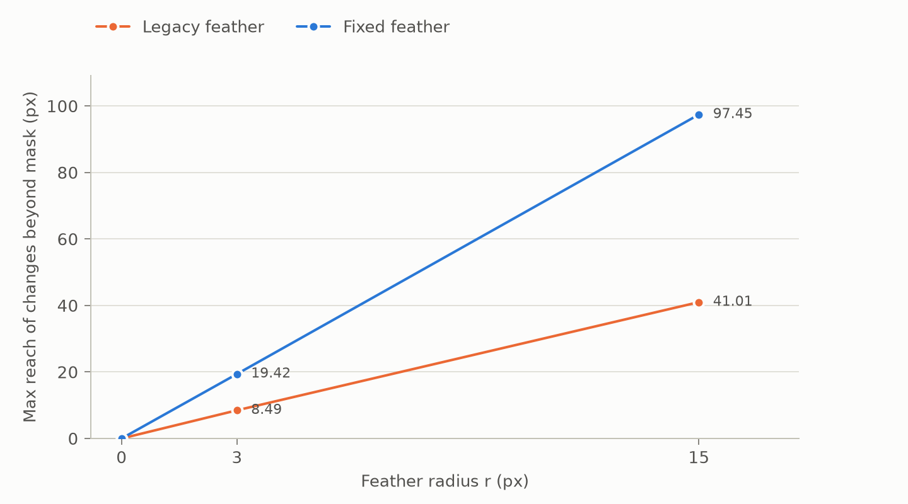

*Chart 4. Furthest distance from the mask at which any pixel changes, for feather radius 0, 3 and 15, measured on the two synthetic test images. The current feather reaches 19.42 and 97.45 px at radius 3 and 15, the legacy feather 8.49 and 41.01 px.*

### Exploring a lower-resolution fill

Above the cap, N2 scored higher than N1 inside the mask, so I tried compositing the 512 px fill with the current feather (C_3_N2fill). It raised M PSNR-Y over C_3 by 1.202, 0.714 and 1.210 dB. That held for 77, 72 and 90 of the 92 images, and M LPIPS improved for 86, 86 and 83 of them.

Outside the mask, the feather blends the blurrier 512 px fill into the halo. Off-repair LPIPS rose by 0.0110, 0.0403 and 0.0825 compared with C_3, and it was worse for all 92 images.

At 5% and 15% coverage, its off-repair LPIPS is even higher than raw N1's: 0.0882 against 0.0833, and 0.1908 against 0.1361. A strong change in a narrow band can cost more on this metric than a faint change everywhere.

Below the cap the 512 px fill was worse inside the mask, by 8.214, 7.151 and 5.179 dB, for 9 of the 10 images. The tenth is small enough that both caps give the same output.

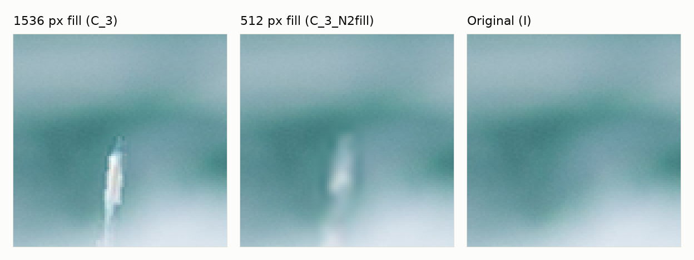

*Figure E. The Figure C edge with the 1536 px fill, the 512 px fill and the original. The 512 px fill is softer and blurrier, but the pale streak is still visible.*

Chart 3 places five outputs on both measures at 5% coverage. C_3_legacy has the lowest off-repair LPIPS, 0.0131, and the highest M LPIPS, 0.1470. Among the composites, C_3_N2fill has the lowest M LPIPS, 0.1164, and the highest off-repair LPIPS, 0.0882.

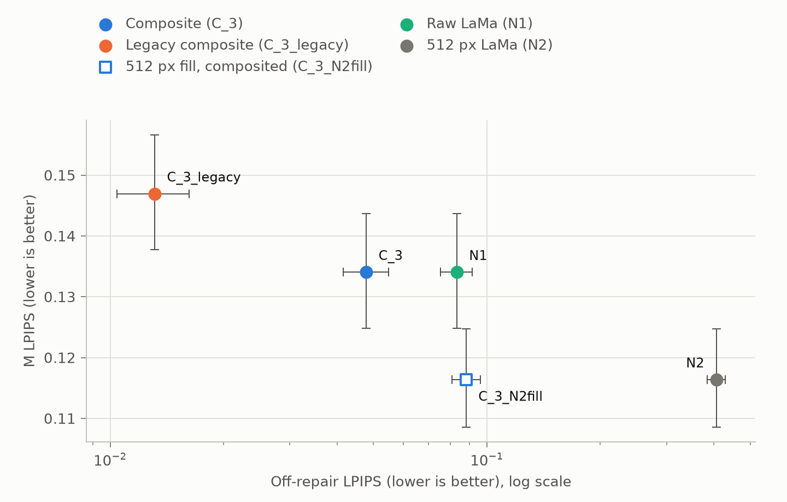

*Chart 3. Off-repair LPIPS against M LPIPS at 5% coverage above the cap, with 95% intervals on both axes and a log x axis. Lower is better on both.*

The paired table lists every per-image comparison behind the three sections above, with intervals and counts.

<!-- BEGIN paired -->

| Size class | Coverage | Comparison (a − b) | Metric | Mean difference [95% CI] | a better / equal / worse | n |
|---|---:|---|---|---:|---:|---:|
| Above cap | 1% | C_3 − C_3_legacy | M PSNR-Y (dB) | +1.183 [+1.090, +1.285] | 92 / 0 / 0 | 92 |
| Above cap | 1% | C_3 − C_3_legacy | M LPIPS | -0.0038 [-0.0041, -0.0034] | 92 / 0 / 0 | 92 |
| Above cap | 1% | C_3 − C_3_legacy | Off-repair LPIPS | +0.0096 [+0.0084, +0.0108] | 0 / 0 / 92 | 92 |
| Above cap | 1% | C_3 − N1 | M PSNR-Y (dB) | +0.000 [+0.000, +0.000] | 0 / 92 / 0 | 92 |
| Above cap | 1% | C_3 − N1 | M LPIPS | +0.0000 [+0.0000, +0.0000] | 0 / 92 / 0 | 92 |
| Above cap | 1% | C_3 − N1 | U mean abs diff | -1.618 [-1.857, -1.405] | 92 / 0 / 0 | 92 |
| Above cap | 1% | C_3 − N2 | M PSNR-Y (dB) | -1.202 [-1.468, -0.931] | 15 / 0 / 77 | 92 |
| Above cap | 1% | C_3 − N2 | M LPIPS | +0.0060 [+0.0051, +0.0069] | 6 / 0 / 86 | 92 |
| Above cap | 1% | C_3 − N2 | U mean abs diff | -5.121 [-5.788, -4.511] | 92 / 0 / 0 | 92 |
| Above cap | 1% | C_3_N2fill − C_3 | M PSNR-Y (dB) | +1.202 [+0.931, +1.468] | 77 / 0 / 15 | 92 |
| Above cap | 1% | C_3_N2fill − C_3 | M LPIPS | -0.0060 [-0.0069, -0.0051] | 86 / 0 / 6 | 92 |
| Above cap | 1% | C_3_N2fill − C_3 | Off-repair LPIPS | +0.0110 [+0.0102, +0.0118] | 0 / 0 / 92 | 92 |
| Above cap | 1% | C_3_N2fill − N2 | M PSNR-Y (dB) | +0.000 [+0.000, +0.000] | 0 / 92 / 0 | 92 |
| Above cap | 1% | C_3_N2fill − N2 | M LPIPS | +0.0000 [+0.0000, +0.0000] | 0 / 92 / 0 | 92 |
| Above cap | 1% | C_3_N2fill − N2 | Off-repair LPIPS | -0.3578 [-0.3828, -0.3336] | 92 / 0 / 0 | 92 |
| Above cap | 5% | C_3 − C_3_legacy | M PSNR-Y (dB) | +1.106 [+1.028, +1.187] | 92 / 0 / 0 | 92 |
| Above cap | 5% | C_3 − C_3_legacy | M LPIPS | -0.0129 [-0.0141, -0.0119] | 92 / 0 / 0 | 92 |
| Above cap | 5% | C_3 − C_3_legacy | Off-repair LPIPS | +0.0348 [+0.0308, +0.0391] | 0 / 0 / 92 | 92 |
| Above cap | 5% | C_3 − N1 | M PSNR-Y (dB) | +0.000 [+0.000, +0.000] | 0 / 92 / 0 | 92 |
| Above cap | 5% | C_3 − N1 | M LPIPS | +0.0000 [+0.0000, +0.0000] | 0 / 92 / 0 | 92 |
| Above cap | 5% | C_3 − N1 | U mean abs diff | -1.565 [-1.797, -1.356] | 92 / 0 / 0 | 92 |
| Above cap | 5% | C_3 − N2 | M PSNR-Y (dB) | -0.714 [-0.919, -0.508] | 20 / 0 / 72 | 92 |
| Above cap | 5% | C_3 − N2 | M LPIPS | +0.0177 [+0.0152, +0.0200] | 6 / 0 / 86 | 92 |
| Above cap | 5% | C_3 − N2 | U mean abs diff | -4.952 [-5.612, -4.327] | 92 / 0 / 0 | 92 |
| Above cap | 5% | C_3_N2fill − C_3 | M PSNR-Y (dB) | +0.714 [+0.508, +0.919] | 72 / 0 / 20 | 92 |
| Above cap | 5% | C_3_N2fill − C_3 | M LPIPS | -0.0177 [-0.0200, -0.0152] | 86 / 0 / 6 | 92 |
| Above cap | 5% | C_3_N2fill − C_3 | Off-repair LPIPS | +0.0403 [+0.0376, +0.0431] | 0 / 0 / 92 | 92 |
| Above cap | 5% | C_3_N2fill − N2 | M PSNR-Y (dB) | +0.000 [+0.000, +0.000] | 0 / 92 / 0 | 92 |
| Above cap | 5% | C_3_N2fill − N2 | M LPIPS | +0.0000 [+0.0000, +0.0000] | 0 / 92 / 0 | 92 |
| Above cap | 5% | C_3_N2fill − N2 | Off-repair LPIPS | -0.3182 [-0.3408, -0.2961] | 92 / 0 / 0 | 92 |
| Above cap | 15% | C_3 − C_3_legacy | M PSNR-Y (dB) | +1.246 [+1.174, +1.319] | 92 / 0 / 0 | 92 |
| Above cap | 15% | C_3 − C_3_legacy | M LPIPS | -0.0250 [-0.0269, -0.0234] | 92 / 0 / 0 | 92 |
| Above cap | 15% | C_3 − C_3_legacy | Off-repair LPIPS | +0.0744 [+0.0667, +0.0827] | 0 / 0 / 92 | 92 |
| Above cap | 15% | C_3 − N1 | M PSNR-Y (dB) | +0.000 [+0.000, +0.000] | 0 / 92 / 0 | 92 |
| Above cap | 15% | C_3 − N1 | M LPIPS | +0.0000 [+0.0000, +0.0000] | 0 / 92 / 0 | 92 |
| Above cap | 15% | C_3 − N1 | U mean abs diff | -1.458 [-1.666, -1.273] | 92 / 0 / 0 | 92 |
| Above cap | 15% | C_3 − N2 | M PSNR-Y (dB) | -1.210 [-1.382, -1.042] | 2 / 0 / 90 | 92 |
| Above cap | 15% | C_3 − N2 | M LPIPS | +0.0257 [+0.0210, +0.0302] | 9 / 0 / 83 | 92 |
| Above cap | 15% | C_3 − N2 | U mean abs diff | -4.611 [-5.234, -4.038] | 92 / 0 / 0 | 92 |
| Above cap | 15% | C_3_N2fill − C_3 | M PSNR-Y (dB) | +1.210 [+1.042, +1.382] | 90 / 0 / 2 | 92 |
| Above cap | 15% | C_3_N2fill − C_3 | M LPIPS | -0.0257 [-0.0302, -0.0210] | 83 / 0 / 9 | 92 |
| Above cap | 15% | C_3_N2fill − C_3 | Off-repair LPIPS | +0.0825 [+0.0774, +0.0878] | 0 / 0 / 92 | 92 |
| Above cap | 15% | C_3_N2fill − N2 | M PSNR-Y (dB) | +0.000 [+0.000, +0.000] | 0 / 92 / 0 | 92 |
| Above cap | 15% | C_3_N2fill − N2 | M LPIPS | +0.0000 [+0.0000, +0.0000] | 0 / 92 / 0 | 92 |
| Above cap | 15% | C_3_N2fill − N2 | Off-repair LPIPS | -0.2426 [-0.2610, -0.2248] | 92 / 0 / 0 | 92 |
| At or below cap | 1% | C_3 − C_3_legacy | M PSNR-Y (dB) | +10.319 [+7.040, +14.008] | 10 / 0 / 0 | 10 |
| At or below cap | 1% | C_3 − C_3_legacy | M LPIPS | -0.0327 [-0.0471, -0.0215] | 10 / 0 / 0 | 10 |
| At or below cap | 1% | C_3 − C_3_legacy | Off-repair LPIPS | +0.0000 [+0.0000, +0.0000] | 0 / 10 / 0 | 10 |
| At or below cap | 1% | C_3 − N1 | M PSNR-Y (dB) | +0.000 [+0.000, +0.000] | 0 / 10 / 0 | 10 |
| At or below cap | 1% | C_3 − N1 | M LPIPS | +0.0000 [+0.0000, +0.0000] | 0 / 10 / 0 | 10 |
| At or below cap | 1% | C_3 − N1 | U mean abs diff | +0.000 [+0.000, +0.000] | 0 / 10 / 0 | 10 |
| At or below cap | 1% | C_3 − N2 | M PSNR-Y (dB) | +8.214 [+5.135, +11.277] | 9 / 1 / 0 | 10 |
| At or below cap | 1% | C_3 − N2 | M LPIPS | -0.0207 [-0.0286, -0.0135] | 9 / 1 / 0 | 10 |
| At or below cap | 1% | C_3 − N2 | U mean abs diff | -5.667 [-7.027, -4.126] | 9 / 1 / 0 | 10 |
| At or below cap | 1% | C_3_N2fill − C_3 | M PSNR-Y (dB) | -8.214 [-11.277, -5.135] | 0 / 1 / 9 | 10 |
| At or below cap | 1% | C_3_N2fill − C_3 | M LPIPS | +0.0207 [+0.0135, +0.0286] | 0 / 1 / 9 | 10 |
| At or below cap | 1% | C_3_N2fill − C_3 | Off-repair LPIPS | +0.0139 [+0.0096, +0.0178] | 0 / 1 / 9 | 10 |
| At or below cap | 1% | C_3_N2fill − N2 | M PSNR-Y (dB) | +0.000 [+0.000, +0.000] | 0 / 10 / 0 | 10 |
| At or below cap | 1% | C_3_N2fill − N2 | M LPIPS | +0.0000 [+0.0000, +0.0000] | 0 / 10 / 0 | 10 |
| At or below cap | 1% | C_3_N2fill − N2 | Off-repair LPIPS | -0.2648 [-0.3435, -0.1837] | 9 / 1 / 0 | 10 |
| At or below cap | 5% | C_3 − C_3_legacy | M PSNR-Y (dB) | +8.175 [+5.734, +11.431] | 10 / 0 / 0 | 10 |
| At or below cap | 5% | C_3 − C_3_legacy | M LPIPS | -0.1091 [-0.1438, -0.0828] | 10 / 0 / 0 | 10 |
| At or below cap | 5% | C_3 − C_3_legacy | Off-repair LPIPS | +0.0000 [+0.0000, +0.0000] | 0 / 10 / 0 | 10 |
| At or below cap | 5% | C_3 − N1 | M PSNR-Y (dB) | +0.000 [+0.000, +0.000] | 0 / 10 / 0 | 10 |
| At or below cap | 5% | C_3 − N1 | M LPIPS | +0.0000 [+0.0000, +0.0000] | 0 / 10 / 0 | 10 |
| At or below cap | 5% | C_3 − N1 | U mean abs diff | +0.000 [+0.000, +0.000] | 0 / 10 / 0 | 10 |
| At or below cap | 5% | C_3 − N2 | M PSNR-Y (dB) | +7.151 [+4.962, +9.219] | 9 / 1 / 0 | 10 |
| At or below cap | 5% | C_3 − N2 | M LPIPS | -0.0798 [-0.1004, -0.0575] | 9 / 1 / 0 | 10 |
| At or below cap | 5% | C_3 − N2 | U mean abs diff | -5.866 [-7.448, -4.121] | 9 / 1 / 0 | 10 |
| At or below cap | 5% | C_3_N2fill − C_3 | M PSNR-Y (dB) | -7.151 [-9.219, -4.962] | 0 / 1 / 9 | 10 |
| At or below cap | 5% | C_3_N2fill − C_3 | M LPIPS | +0.0798 [+0.0575, +0.1004] | 0 / 1 / 9 | 10 |
| At or below cap | 5% | C_3_N2fill − C_3 | Off-repair LPIPS | +0.0507 [+0.0370, +0.0619] | 0 / 1 / 9 | 10 |
| At or below cap | 5% | C_3_N2fill − N2 | M PSNR-Y (dB) | +0.000 [+0.000, +0.000] | 0 / 10 / 0 | 10 |
| At or below cap | 5% | C_3_N2fill − N2 | M LPIPS | +0.0000 [+0.0000, +0.0000] | 0 / 10 / 0 | 10 |
| At or below cap | 5% | C_3_N2fill − N2 | Off-repair LPIPS | -0.2354 [-0.3072, -0.1626] | 9 / 1 / 0 | 10 |
| At or below cap | 15% | C_3 − C_3_legacy | M PSNR-Y (dB) | +6.297 [+4.163, +8.806] | 10 / 0 / 0 | 10 |
| At or below cap | 15% | C_3 − C_3_legacy | M LPIPS | -0.2044 [-0.2585, -0.1592] | 10 / 0 / 0 | 10 |
| At or below cap | 15% | C_3 − C_3_legacy | Off-repair LPIPS | +0.0000 [+0.0000, +0.0000] | 0 / 10 / 0 | 10 |
| At or below cap | 15% | C_3 − N1 | M PSNR-Y (dB) | +0.000 [+0.000, +0.000] | 0 / 10 / 0 | 10 |
| At or below cap | 15% | C_3 − N1 | M LPIPS | +0.0000 [+0.0000, +0.0000] | 0 / 10 / 0 | 10 |
| At or below cap | 15% | C_3 − N1 | U mean abs diff | +0.000 [+0.000, +0.000] | 0 / 8 / 0 | 8 (2 u_empty excluded) |
| At or below cap | 15% | C_3 − N2 | M PSNR-Y (dB) | +5.179 [+3.330, +6.959] | 9 / 1 / 0 | 10 |
| At or below cap | 15% | C_3 − N2 | M LPIPS | -0.1609 [-0.2019, -0.1162] | 9 / 1 / 0 | 10 |
| At or below cap | 15% | C_3 − N2 | U mean abs diff | -6.977 [-10.359, -4.331] | 8 / 0 / 0 | 8 (2 u_empty excluded) |
| At or below cap | 15% | C_3_N2fill − C_3 | M PSNR-Y (dB) | -5.179 [-6.959, -3.330] | 0 / 1 / 9 | 10 |
| At or below cap | 15% | C_3_N2fill − C_3 | M LPIPS | +0.1609 [+0.1162, +0.2019] | 0 / 1 / 9 | 10 |
| At or below cap | 15% | C_3_N2fill − C_3 | Off-repair LPIPS | +0.1086 [+0.0782, +0.1349] | 0 / 1 / 9 | 10 |
| At or below cap | 15% | C_3_N2fill − N2 | M PSNR-Y (dB) | +0.000 [+0.000, +0.000] | 0 / 10 / 0 | 10 |
| At or below cap | 15% | C_3_N2fill − N2 | M LPIPS | +0.0000 [+0.0000, +0.0000] | 0 / 10 / 0 | 10 |
| At or below cap | 15% | C_3_N2fill − N2 | Off-repair LPIPS | -0.1755 [-0.2310, -0.1194] | 9 / 1 / 0 | 10 |

<!-- END paired -->

### Upscaler input handling

Auto Restore and the Benchmark tab can ask Real-ESRGAN for 2x output, but the network I use always upscales by 4x. The old code first shrank the input to half size, so that 4x would land on 2x. That discarded detail before the network saw it.

The current code runs the 4x network on the full input, in 256 px tiles with 16 px of context. It then resamples the result to the target size with Lanczos. I compared both paths on 10 Mobile crops of 512 by 512 px. Each crop was downscaled by 2x, blurred, given noise and saved as JPEG at quality 60, then restored.

<!-- BEGIN upscaler -->

| Method (10 Mobile crops, 512×512) | PSNR-Y (dB) mean | min | max | SSIM-Y mean | min | max | LPIPS mean | min | max |
|---|---:|---:|---:|---:|---:|---:|---:|---:|---:|
| Bicubic | 29.97 | 24.86 | 37.48 | 0.7967 | 0.6140 | 0.9074 | 0.4682 | 0.3137 | 0.6745 |
| Real-ESRGAN, old path | 28.88 | 23.13 | 38.61 | 0.7940 | 0.5628 | 0.9550 | 0.2099 | 0.1254 | 0.3059 |
| Real-ESRGAN, fixed path | 30.28 | 24.82 | 39.09 | 0.8320 | 0.6125 | 0.9586 | 0.1843 | 0.1237 | 0.2347 |

<!-- END upscaler -->

Mean PSNR-Y rose from 28.88 to 30.28 dB and mean SSIM-Y [12] from 0.7940 to 0.8320. Mean LPIPS fell from 0.2099 to 0.1843. The current path beat the old one on PSNR-Y and SSIM-Y for all 10 crops, and on LPIPS for 9.

Against bicubic interpolation the current path won on LPIPS for all 10 crops but on PSNR-Y for only 5. Its mean PSNR-Y of 30.28 dB is close to bicubic's 29.97 dB.

The fix costs time. With a 512 px input, the median time on the CPU rose from 13.59 s to 52.80 s. On Apple's MPS backend it rose from 1.57 s to 7.81 s.

## What works well

The compositing guarantee is exact. No composite changed a single U pixel in any pair. The test suite checks the same property at zero tolerance on two image sizes and at radius 0, 3 and 15.

The current feather gives LaMa's fill full weight across the mask, and it raised M PSNR-Y in every pair.

Below the cap, raw LaMa changed no pixel in U, and its off-repair LPIPS was 0. On the one image tested, the fill check below also found that its output did not depend on the damage colour there.

Masks and fills are seeded, and the raw per-pair results are in the repository. Each figure's image and crop come from a recorded rule, not from a choice by eye.

## Areas for improvement and next steps

### Fill colour above the cap

C_3's M PSNR-Y is much lower above the cap than below it. That gap made me check whether LaMa sees the damage fill. I ran LaMa twice on the representative image at 5% coverage, once with the experiment's fill and once with black.

Above the cap, 117,931 of the 117,936 mask pixels (99.996%) differed between the two outputs, by up to 255 levels. Differences also reached 83,870 pixels outside the mask, by up to 181 levels and up to 8.49 px from it. All of them fell inside the radius 3 feather, and none fell in U.

On the largest Professional image at or below the cap, 1500 by 844 px, the two outputs were identical. On that image, LaMa ignored the masked pixels when it saw the image at full size.

Above the cap, two effects could let the fill through, and I have not yet separated them. The Lanczos downscale mixes fill colour into neighbouring unmasked pixels. Nearest-neighbour downscaling of the mask can also drop parts of thin strokes.

This check uses one image per size class. It shows that the dependence exists, but it does not measure its average size. The two size classes also contain different images, so the PSNR-Y gap between them is not a clean measure of the effect.

### Next experiment: mask-aware downscaling

Exclude masked pixels when downscaling the image, for example with normalised convolution. Mark a low-resolution pixel as masked when any of its source pixels is masked. I would count this a success if the fill check above the cap then reports identical outputs. I would then rerun the full experiment to see how M PSNR-Y changes.

### Next experiment: full-resolution crops

IOPaint's Crop strategy suggests a second route. Cut a margin around each mask region and inpaint that crop at native resolution whenever it fits under the cap. Small repairs would then avoid resampling altogether. I would compare this with the current path on the same 306 pairs, using M PSNR-Y, M LPIPS, off-repair LPIPS and runtime.

### Other limits

The damage is synthetic, a bright noisy fill in strokes and blobs, not real scratches or tears. Only 10 images are at or below the cap, so that class has wide intervals. For example, C_3's M PSNR-Y at 1% has an interval of 19.97 to 26.04 dB. At 15% coverage U covers on average 8.88% of an above-cap image, so U figures there rest on fewer pixels.

M PSNR-Y compares the fill with the original, so a plausible fill that differs from the original counts as error. The upscaler comparison uses 10 crops and one degradation setting, and all timings come from one machine.

## Reproducing this

```bash
python3.11 -m venv venv
./venv/bin/pip install -r requirements.txt -r requirements-dev.txt
./venv/bin/pip install --no-deps pyiqa==0.1.15.post2
./venv/bin/pip install timm==1.0.27 openai-clip==1.0.1 ftfy==6.3.1 regex==2026.5.9 requests==2.34.2
```

```bash
./venv/bin/python -I scripts/fetch_data.py
```

```bash
./venv/bin/python scripts/run_compositing_experiment.py --preflight-only
./venv/bin/python scripts/run_compositing_experiment.py --out results/compositing_repro
```

```bash
./venv/bin/python scripts/summarise_compositing.py --dir results/compositing_repro
```

Make the figures and tables (from the committed results in results/compositing/):

```bash
./venv/bin/python scripts/make_figures.py
./venv/bin/python scripts/make_tables.py
```

## References

1. R. Suvorov, E. Logacheva, A. Mashikhin, A. Remizova, A. Ashukha, A. Silvestrov, N. Kong, H. Goka, K. Park and V. Lempitsky. "Resolution-robust Large Mask Inpainting with Fourier Convolutions." IEEE/CVF Winter Conference on Applications of Computer Vision (WACV), 2022, pp. 2149–2159. <https://openaccess.thecvf.com/content/WACV2022/html/Suvorov_Resolution-Robust_Large_Mask_Inpainting_With_Fourier_Convolutions_WACV_2022_paper.html>
2. X. Wang, L. Xie, C. Dong and Y. Shan. "Real-ESRGAN: Training Real-World Blind Super-Resolution with Pure Synthetic Data." IEEE/CVF International Conference on Computer Vision Workshops (ICCVW), 2021, pp. 1905–1914. <https://openaccess.thecvf.com/content/ICCV2021W/AIM/html/Wang_Real-ESRGAN_Training_Real-World_Blind_Super-Resolution_With_Pure_Synthetic_Data_ICCVW_2021_paper.html>
3. S. Zhou, K. C. K. Chan, C. Li and C. C. Loy. "Towards Robust Blind Face Restoration with Codebook Lookup Transformer." Advances in Neural Information Processing Systems (NeurIPS), 2022. <https://arxiv.org/abs/2206.11253>
4. simple-lama-inpainting, a pip package for LaMa inpainting. <https://github.com/enesmsahin/simple-lama-inpainting>
5. spandrel, a library for loading and running pre-trained PyTorch models, from the chaiNNer project. <https://github.com/chaiNNer-org/spandrel>
6. IOPaint, by Sanster, renamed from lama-cleaner. Its Original, Resize and Crop strategies are defined in `iopaint/schema.py`. <https://github.com/Sanster/IOPaint>; rename announcement: <https://github.com/Sanster/IOPaint/discussions/420>
7. G. Toderici, W. Shi, R. Timofte, L. Theis, J. Ballé, E. Agustsson, N. Johnston and F. Mentzer. "Workshop and Challenge on Learned Image Compression (CLIC2020)." CVPR, 2020. <https://www.compression.cc>
8. P. Gwosdek, S. Grewenig, A. Bruhn and J. Weickert. "Theoretical Foundations of Gaussian Convolution by Extended Box Filtering." Scale Space and Variational Methods in Computer Vision (SSVM), 2011. Title and authors verified; proceedings volume and pages not verified. <https://www.mia.uni-saarland.de/Publications/gwosdek-ssvm11.pdf>
9. ITU-R Recommendation BT.601-7. "Studio encoding parameters of digital television for standard 4:3 and wide screen 16:9 aspect ratios." International Telecommunication Union, 2011. <https://www.itu.int/rec/R-REC-BT.601>
10. R. Zhang, P. Isola, A. A. Efros, E. Shechtman and O. Wang. "The Unreasonable Effectiveness of Deep Features as a Perceptual Metric." IEEE/CVF Conference on Computer Vision and Pattern Recognition (CVPR), 2018, pp. 586–595. <https://openaccess.thecvf.com/content_cvpr_2018/html/Zhang_The_Unreasonable_Effectiveness_CVPR_2018_paper.html>
11. C. Chen and J. Mo. "IQA-PyTorch: PyTorch Toolbox for Image Quality Assessment" (pyiqa), 2022. <https://github.com/chaofengc/IQA-PyTorch>
12. Z. Wang, A. C. Bovik, H. R. Sheikh and E. P. Simoncelli. "Image Quality Assessment: From Error Visibility to Structural Similarity." IEEE Transactions on Image Processing, 13(4), pp. 600–612, 2004. <https://doi.org/10.1109/TIP.2003.819861>

## Credits

<!-- BEGIN credits -->

| Image | Split | Licence | Licence source | Dataset source |
|---|---|---|---|---|
| jeremy-cai-1174.png | professional | Unsplash License | <https://data.vision.ee.ethz.ch/cvl/clic/LICENSE_professional_2020.txt> | <https://downloads.compression.cc/clic2020_professional_valid.zip> |

<!-- END credits -->
